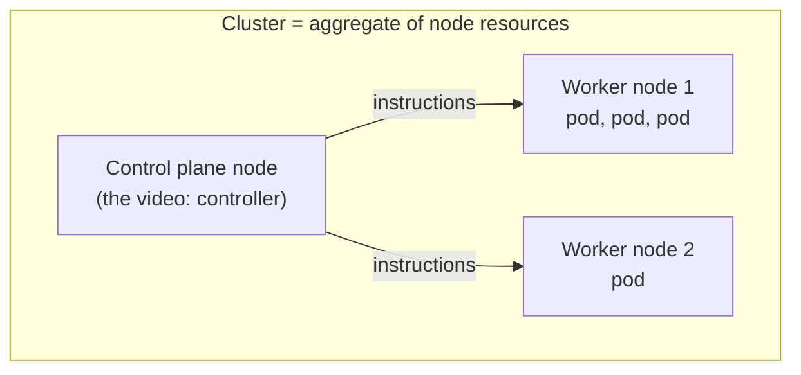
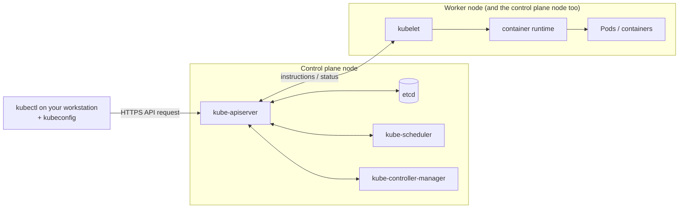
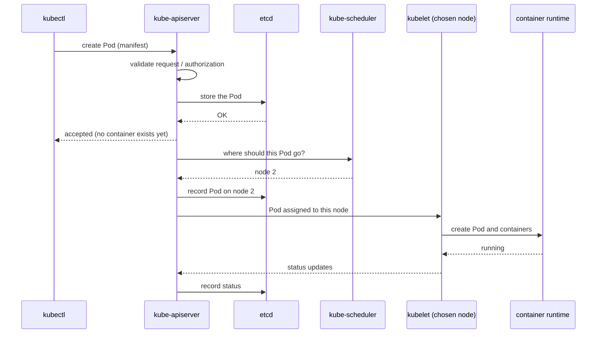
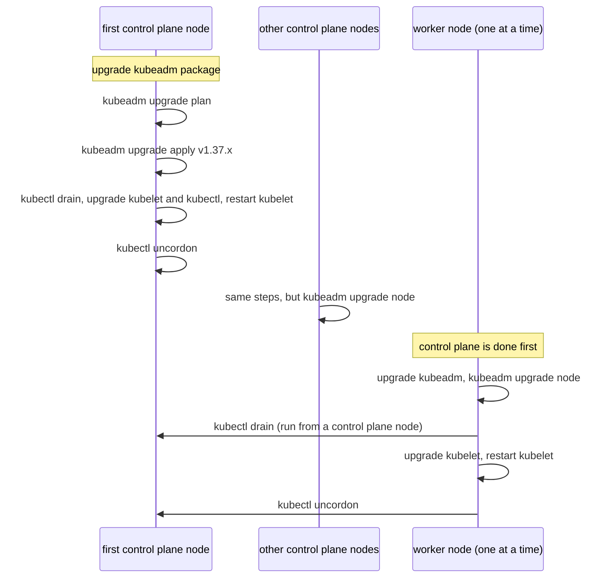
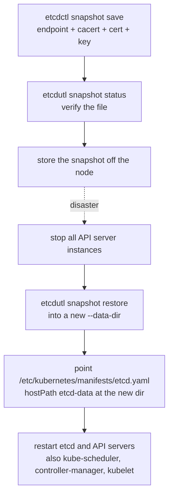
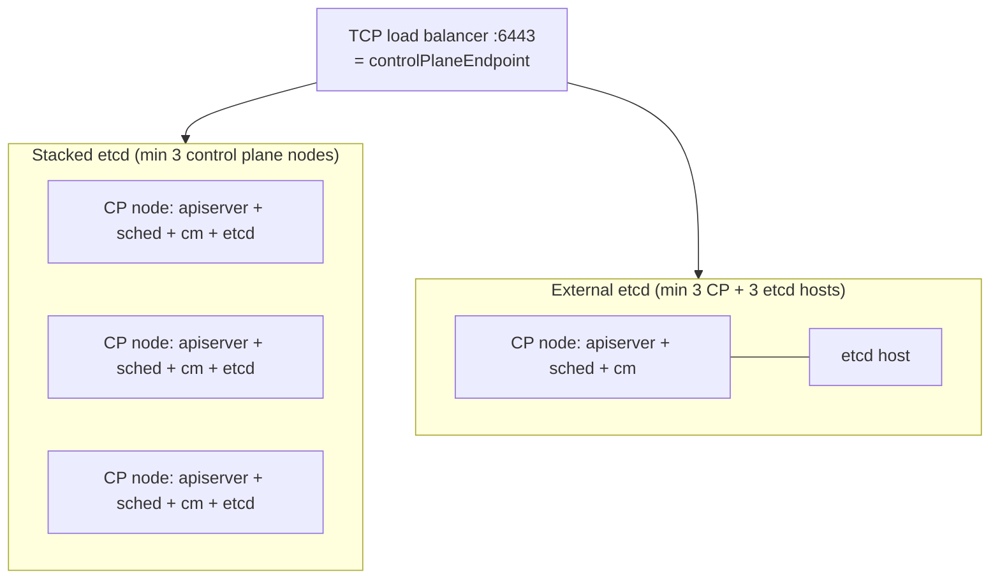

# Cluster Architecture, Installation & Configuration (25%)

CKA domain (CNCF curriculum v1.37 bullets): manage RBAC; prepare infrastructure for a cluster; create and manage clusters with kubeadm; manage the cluster lifecycle; implement a highly-available control plane; use Helm and Kustomize to install cluster components; understand extension interfaces (CNI, CSI, CRI); understand CRDs and operators. Target: Kubernetes v1.37.

Video: Alta3 Research, "Kubernetes Zero to Hero". The Architecture chapter (102s) is the only video content for this domain; everything from "Prepare infrastructure" onward comes from kubernetes.io/docs (URL cited per section). Runnable manifests live in [`examples/01-cluster/`](../examples/01-cluster/). Cluster for experiments: `kind create cluster --name cka-study --config examples/kind-config.yaml`.

Curriculum mapping for sections that are not a bullet by name: etcd snapshot/restore and `kubeadm certs` fall under "manage the lifecycle of clusters"; ServiceAccounts are RBAC subjects; kubeconfig/contexts are how `kubectl` reaches the cluster and are needed to test RBAC with `--as`.

Not run live (destructive on the shared kind cluster): `kubeadm init/join/upgrade/reset`, etcd restore, certificate renewal, draining the control plane. Those sections are copied from kubernetes.io and marked "not run live". Read-only and throwaway checks were run and are labelled "Live check".

## Cluster, nodes and pods
<!-- chapter: Architecture -->
[video 01:43](https://www.youtube.com/watch?v=MTHGoGUFpvE&t=103s) | [video 05:38](https://www.youtube.com/watch?v=MTHGoGUFpvE&t=338s)



- Container = code plus its dependencies in an isolated environment; easy to start, replace and scale, and not meant to live forever.
- Without orchestration a host that runs out of resources blocks scaling, dead containers are ignored, and a dead VM takes every container with it. Kubernetes is the answer to all three.
- Kubernetes manages Pods (a wrapper around containers), not bare containers.
- A machine added to Kubernetes is a node; nodes together form a cluster. Two flavours: worker nodes carry the Pods (different sizes, different Pod counts); the control plane node runs the tooling that keeps the cluster running.
- Do not put your own Pods on the control plane node: it needs its resources to manage the cluster. kubeadm enforces this with a taint (see "Create a cluster with kubeadm").

## Component map: who does what
<!-- chapter: Architecture -->
[video 07:40](https://www.youtube.com/watch?v=MTHGoGUFpvE&t=460s) | [video 10:29](https://www.youtube.com/watch?v=MTHGoGUFpvE&t=629s) | [video 13:24](https://www.youtube.com/watch?v=MTHGoGUFpvE&t=804s) | docs: https://kubernetes.io/docs/concepts/overview/components/



- `kubectl` is the CLI installed on your own machine. Every request it sends is received by the API server on the control plane node. Everything in the cluster talks through the API.
- kubeconfig ([video 08:56](https://www.youtube.com/watch?v=MTHGoGUFpvE&t=536s)): a file on the same machine as `kubectl` holding the cluster location and the certificate and key that authenticate you. Without it `kubectl` cannot work.
- API server ([video 09:34](https://www.youtube.com/watch?v=MTHGoGUFpvE&t=574s)): decides whether a request is valid, then acts or returns data; reaches every node; the only component that talks to etcd.
- etcd: strongly consistent distributed key-value store that holds cluster state (nodes, Pods, their health). Third-party and older than Kubernetes. Losing it means losing track of everything that runs ("lobotomizing" the cluster, in the video's words).
- Scheduler ([video 11:46](https://www.youtube.com/watch?v=MTHGoGUFpvE&t=706s)): picks the node for each Pod, spreading load and obeying rules you or the system set. Docs: "Looks for Pods not yet bound to a node, and assigns each Pod to a suitable node."
- Controller manager ([video 12:35](https://www.youtube.com/watch?v=MTHGoGUFpvE&t=755s)): the "sheriff" running the control loops. Docs: "Runs controllers to implement Kubernetes API behavior."
- kubelet ([video 13:24](https://www.youtube.com/watch?v=MTHGoGUFpvE&t=804s)): runs on every node, control plane node included; starts, stops and restarts containers on instruction from the control plane and reports back. If it is broken, the node is cut off from the cluster. Docs: "Ensures that Pods are running, including their containers."
- Container runtime ([video 14:13](https://www.youtube.com/watch?v=MTHGoGUFpvE&t=853s)): Docker, containerd or similar on every node; the kubelet issues the equivalent of `docker run`, not Kubernetes itself. Images come from registries.
- Docs also list `kube-proxy` (optional, "Maintains network rules on nodes to implement Services") and `cloud-controller-manager` (optional, "Integrates with underlying cloud provider(s)"), which the video does not cover.
- Live check on kind (example output, names differ in your cluster): the control plane components run as static Pods in `kube-system`, and `/etc/kubernetes/manifests` on the control plane node holds their manifests.

```bash
kubectl -n kube-system get pods          # etcd-*, kube-apiserver-*, kube-controller-manager-*, kube-scheduler-*, coredns, kube-proxy, kindnet
docker exec cka-study-control-plane ls /etc/kubernetes/manifests
# etcd.yaml  kube-apiserver.yaml  kube-controller-manager.yaml  kube-scheduler.yaml
```

## Creating a Pod: the request flow
<!-- chapter: Architecture -->
[video 16:20](https://www.youtube.com/watch?v=MTHGoGUFpvE&t=980s)



- Order in the video: kubectl -> API server; the API server rejects typos or unauthorized requests, otherwise stores the Pod in etcd (HTTP 200 back); the scheduler picks a node (only if the manifest did not pin one); the API server records the choice in etcd; the kubelet on that node builds the Pod and then its containers; the kubelet keeps reporting status through the API server into etcd.
- The video draws the scheduler and kubelet as being called by the API server. The docs describe the scheduler as looking for Pods not yet bound to a node, so treat the arrows as a teaching simplification of "the API server holds the state; components act on it".
- The Pod exists before its container: the kubelet makes the Pod first, then the container in it.
- Exam use: when something is stuck, ask which hop failed. Request rejected (API server/auth), `Pending` with no node (scheduler), assigned but not running (kubelet/runtime/image).

## Prepare infrastructure: kubeadm prerequisites and container runtime
<!-- gap -->
docs: https://kubernetes.io/docs/setup/production-environment/tools/kubeadm/install-kubeadm/ | https://kubernetes.io/docs/setup/production-environment/container-runtimes/ | https://kubernetes.io/docs/concepts/containers/cri/

Machine requirements (install-kubeadm page): a compatible Linux host; 2 GB or more RAM per machine; 2 CPUs or more for control plane machines; full network connectivity between machines; unique hostname, MAC address and product_uuid per node; certain ports open.

```bash
sudo cat /sys/class/dmi/id/product_uuid     # unique per node
ip link                                      # MAC addresses (or: ifconfig -a)
nc 127.0.0.1 6443 -zv -w 2                   # check a port, e.g. the API server
sudo swapoff -a                              # swap off now; also remove it from /etc/fstab or systemd.swap to persist
```

IPv4 forwarding (container-runtimes page; some network implementations expect you to do it):

```bash
cat <<EOF | sudo tee /etc/sysctl.d/k8s.conf
net.ipv4.ip_forward = 1
EOF
sudo sysctl --system
sysctl net.ipv4.ip_forward                   # verify
```

cgroup driver: the kubelet and the container runtime must use the same driver; `systemd` is the one to use when systemd is the init system (docs call `cgroupfs` not recommended there).

```yaml
apiVersion: kubelet.config.k8s.io/v1beta1
kind: KubeletConfiguration
cgroupDriver: systemd
```

containerd: config is `/etc/containerd/config.toml`; for containerd 2.x set the runc option below, for 1.x the section is `[plugins."io.containerd.grpc.v1.cri".containerd.runtimes.runc.options]`. Then restart.

```toml
[plugins.'io.containerd.cri.v1.runtime'.containerd.runtimes.runc]
  ...
  [plugins.'io.containerd.cri.v1.runtime'.containerd.runtimes.runc.options]
    SystemdCgroup = true
```

```bash
sudo systemctl restart containerd
```

Default CRI sockets (container-runtimes page): containerd `/run/containerd/containerd.sock`; CRI-O `/var/run/crio/crio.sock`; cri-dockerd `/run/cri-dockerd.sock`. The runtime must support the CRI `v1` API or the kubelet will not register the node (Kubernetes v1.26 and later). The kubelet flag for the endpoint is `--container-runtime-endpoint`; kubeadm takes `--cri-socket`.

Live check on kind (example): the node runs containerd with `SystemdCgroup = true`, `net.ipv4.ip_forward = 1`, and the kubelet config has `cgroupDriver: systemd` and `containerRuntimeEndpoint: unix:///run/containerd/containerd.sock`.

## Install kubeadm, kubelet and kubectl
<!-- gap -->
docs: https://kubernetes.io/docs/setup/production-environment/tools/kubeadm/install-kubeadm/ (not run live)

```bash
sudo apt-get update
sudo apt-get install -y kubelet kubeadm kubectl
sudo apt-mark hold kubelet kubeadm kubectl      # pin the versions
sudo systemctl enable --now kubelet             # optional, before kubeadm
```

- The page has a package-repository step before these commands; it is not reproduced here, so open the page for your target version.
- After enabling, the kubelet restarts every few seconds, waiting in a crashloop for kubeadm to tell it what to do. That is expected.

## Create a cluster with kubeadm
<!-- gap -->
docs: https://kubernetes.io/docs/setup/production-environment/tools/kubeadm/create-cluster-kubeadm/ | https://kubernetes.io/docs/reference/setup-tools/kubeadm/kubeadm-token/ | https://kubernetes.io/docs/reference/setup-tools/kubeadm/kubeadm-config/ | https://kubernetes.io/docs/reference/setup-tools/kubeadm/kubeadm-init/ (not run live)

```bash
sudo kubeadm init <args>      # on the control plane node
# useful args named on the page:
#   --control-plane-endpoint   shared endpoint for all control plane nodes (set it if you may go HA later)
#   --pod-network-cidr         provider-specific value for some CNI add-ons
#   --apiserver-advertise-address
#   --cri-socket               when more than one runtime is installed
#   --kubernetes-version, --config
#   --dry-run                  don't apply any changes; just output what would be done
```

Same settings from a file ([`examples/01-cluster/kubeadm-config.yaml`](../examples/01-cluster/kubeadm-config.yaml); `kubeadm.k8s.io/v1beta4`):

```bash
kubeadm init --config kubeadm-config.yaml
kubeadm config print init-defaults        # the default InitConfiguration + ClusterConfiguration
kubeadm config validate --config kubeadm-config.yaml
```

After init, set up `kubectl` (regular user, or root):

```bash
mkdir -p $HOME/.kube
sudo cp -i /etc/kubernetes/admin.conf $HOME/.kube/config
sudo chown $(id -u):$(id -g) $HOME/.kube/config
# root alternative:
export KUBECONFIG=/etc/kubernetes/admin.conf
```

Install exactly one Pod network (CNI) add-on, then check CoreDNS:

```bash
kubectl apply -f <add-on.yaml>
kubectl get pods --all-namespaces         # CoreDNS Pod should become Running
```

Join workers (command printed by `kubeadm init`), and regenerate it later:

```bash
kubeadm join <control-plane-host>:<control-plane-port> --token <token> --discovery-token-ca-cert-hash sha256:<hash>
kubeadm token create --print-join-command
kubeadm token list
```

- Bootstrap tokens expire after 24 hours by default (`--ttl` default `24h0m0s`); `0` means never.
- CoreDNS will not start before a Pod network is installed. The Pod network must not overlap host networks; if it does, pick another CIDR for `--pod-network-cidr` and the add-on YAML. kubeadm enforces RBAC, so the add-on must support it.
- Single-node lab: remove the control plane taint so Pods can schedule there:

```bash
kubectl taint nodes --all node-role.kubernetes.io/control-plane-
```

- Config API reference: https://kubernetes.io/docs/reference/config-api/kubeadm-config.v1beta4/ documents `networking.podSubnet` ("the subnet used by Pods"), `serviceSubnet` (default `10.96.0.0/12`), `controlPlaneEndpoint` (stable IP or DNS name for the control plane; with several control plane instances, the address of the external load balancer) and `kubernetesVersion` (target control plane version).
- Live check: `kubeadm config validate --config /dev/stdin` on the kind control plane node accepted `examples/01-cluster/kubeadm-config.yaml` (output `ok`); `kubeadm config print init-defaults` there showed `apiVersion: kubeadm.k8s.io/v1beta4`, `certificatesDir: /etc/kubernetes/pki`, `etcd.local.dataDir: /var/lib/etcd`.

## Upgrade a kubeadm cluster
<!-- gap -->
docs: https://kubernetes.io/docs/tasks/administer-cluster/kubeadm/kubeadm-upgrade/ | https://kubernetes.io/docs/tasks/administer-cluster/kubeadm/upgrading-linux-nodes/ (not run live)



- Supported path: from 1.36.x to 1.37.x, or 1.37.x to 1.37.y (y > x). Skipping minor versions is unsupported. Control plane nodes first, one at a time; the first must have `/etc/kubernetes/admin.conf`. Swap must be disabled; back up app state first. `kubeadm upgrade` does not touch workloads, only Kubernetes components.

First control plane node:

```bash
# find the target version
sudo apt update
sudo apt-cache madison kubeadm            # latest 1.37.x-*
# upgrade kubeadm (replace x with the latest patch version)
sudo apt-mark unhold kubeadm && \
sudo apt-get update && sudo apt-get install -y kubeadm='1.37.x-*' && \
sudo apt-mark hold kubeadm
sudo kubeadm upgrade plan
sudo kubeadm upgrade apply v1.37.x
# prepare the node for maintenance
kubectl drain <node-to-drain> --ignore-daemonsets
# upgrade kubelet and kubectl
sudo apt-mark unhold kubelet kubectl && \
sudo apt-get update && sudo apt-get install -y kubelet='1.37.x-*' kubectl='1.37.x-*' && \
sudo apt-mark hold kubelet kubectl
sudo systemctl daemon-reload
sudo systemctl restart kubelet
kubectl uncordon <node-to-uncordon>
```

Other control plane nodes: same steps, but `sudo kubeadm upgrade node` instead of `kubeadm upgrade apply` (and no `plan`).

Each worker node (one or a few at a time, keeping the minimum capacity your workloads need):

```bash
# on the worker (replace x in 1.37.x-* with the latest patch version)
sudo apt-mark unhold kubeadm kubectl && \
sudo apt-get update && sudo apt-get install -y kubeadm='1.37.x-*' kubectl='1.37.x-*' && \
sudo apt-mark hold kubeadm kubectl
sudo kubeadm upgrade node
# on a control plane node
kubectl drain <node-to-drain> --ignore-daemonsets
# on the worker
sudo apt-mark unhold kubelet && \
sudo apt-get update && sudo apt-get install -y kubelet='1.37.x-*' && \
sudo apt-mark hold kubelet
sudo systemctl daemon-reload
sudo systemctl restart kubelet
# on a control plane node
kubectl uncordon <node-to-uncordon>
kubectl get nodes                          # STATUS Ready and the new version on every node
```

- Docs: a minor-version kubelet upgrade requires draining the node first.
- If the upgrade includes an etcd upgrade, the page suggests stopping kube-apiserver a few seconds before `kubeadm upgrade apply` so in-flight requests finish (`killall -s SIGTERM kube-apiserver`, `sleep 20`, then the upgrade command).
- kubeadm renews all certificates during a control plane upgrade (see "Certificate management").

## etcd backup and restore
<!-- gap -->
docs: https://kubernetes.io/docs/tasks/administer-cluster/configure-upgrade-etcd/



Save (the page's flag form; cert files come from the etcd Pod description):

```bash
ETCDCTL_API=3 etcdctl --endpoints=https://127.0.0.1:2379 \
  --cacert=<trusted-ca-file> --cert=<cert-file> --key=<key-file> \
  snapshot save <backup-file-location>

etcdutl --write-out=table snapshot status snapshot.db      # verify; etcdctl snapshot status is deprecated
```

Where the values come from on a kubeadm cluster: the etcd static Pod manifest.

```bash
grep -E -- '--(cert-file|key-file|trusted-ca-file|data-dir|listen-client-urls)' /etc/kubernetes/manifests/etcd.yaml
# --cert-file=/etc/kubernetes/pki/etcd/server.crt
# --key-file=/etc/kubernetes/pki/etcd/server.key
# --trusted-ca-file=/etc/kubernetes/pki/etcd/ca.crt
# --data-dir=/var/lib/etcd
# --listen-client-urls=https://127.0.0.1:2379,https://<node-ip>:2379
```

Live check on kind (example; the node image has no `etcdctl`, so it was run inside the etcd Pod, which has `etcdctl` and `etcdutl` but no shell). The snapshot went to `/tmp` inside the etcd container only:

```bash
kubectl -n kube-system exec etcd-cka-study-control-plane -- etcdctl \
  --endpoints=https://127.0.0.1:2379 --cacert=/etc/kubernetes/pki/etcd/ca.crt \
  --cert=/etc/kubernetes/pki/etcd/server.crt --key=/etc/kubernetes/pki/etcd/server.key \
  snapshot save /tmp/snap.db
# Snapshot saved at /tmp/snap.db
kubectl -n kube-system exec etcd-cka-study-control-plane -- etcdutl --write-out=table snapshot status /tmp/snap.db
# HASH d6f6ce6 | REVISION 3278 | TOTAL KEYS 557 | TOTAL SIZE 3.7 MB | VERSION 3.7.0   (example values)
```

Restore (not run live):

```bash
etcdutl --data-dir <data-dir-location> snapshot restore snapshot.db
```

- `<data-dir-location>` is created by the restore. If it is the same folder as before, delete it and stop etcd first.
- If API servers are running, do not restore etcd directly: stop all API server instances, restore state in all etcd instances, restart all API server instances. Docs also recommend restarting `kube-scheduler`, `kube-controller-manager` and `kubelet`.
- Otherwise change `/etc/kubernetes/manifests/etcd.yaml` `volumes.hostPath.path` for `name: etcd-data` to the new directory, then either or both of:

```bash
kubectl -n kube-system delete pod <name-of-etcd-pod>
systemctl restart kubelet.service
```

- On a kubeadm cluster also set `etcd.local.dataDir` to the new directory in the `kubeadm-config` ConfigMap, otherwise the next `kubeadm upgrade` writes an etcd manifest for the old directory.
- `etcdctl` is the network client for day-to-day operations; `etcdutl` works directly on data files (restore, defrag, status). Restore uses `etcdutl`; the `etcdctl` restore is the deprecated form.

## Certificate management (kubeadm certs)
<!-- gap -->
docs: https://kubernetes.io/docs/tasks/administer-cluster/kubeadm/kubeadm-certs/ (renewal not run live)

```bash
kubeadm certs check-expiration            # read-only
kubeadm certs renew all                   # on every control plane node if the control plane is replicated
```

Live check on kind (example output, abridged; dates are this cluster's):

```
CERTIFICATE                EXPIRES                  RESIDUAL TIME   CERTIFICATE AUTHORITY   EXTERNALLY MANAGED
admin.conf                 Nov 07, 2027 19:21 UTC   364d            ca                      no
apiserver                  Nov 07, 2027 19:21 UTC   364d            ca                      no
etcd-server                Nov 07, 2027 19:21 UTC   364d            etcd-ca                 no
CERTIFICATE AUTHORITY   EXPIRES                  RESIDUAL TIME   EXTERNALLY MANAGED
ca                      Nov 04, 2036 19:21 UTC   9y              no
```

- Leaf certs default to 1 year (`certificateValidityPeriod` `8760h`), CAs to 10 years (`caCertificateValidityPeriod` `87600h`). Certificates live in `/etc/kubernetes/pki` (`certificatesDir`).
- kubeadm renews all certificates during a control plane upgrade; opt out with `--certificate-renewal=false` on `kubeadm upgrade apply` or `kubeadm upgrade node`.
- After a manual renewal restart the control plane Pods (no dynamic reload for every component). They are static Pods, so `kubectl` cannot delete them: move the manifest out of `/etc/kubernetes/manifests/`, wait 20 seconds (`fileCheckFrequency`), move it back.
- `kubelet.conf` is not in the list: kubeadm configures automatic rotation of kubelet client certs under `/var/lib/kubelet/pki`.

## High-availability control plane
<!-- gap -->
docs: https://kubernetes.io/docs/setup/production-environment/tools/kubeadm/ha-topology/ | https://kubernetes.io/docs/setup/production-environment/tools/kubeadm/high-availability/ (not run live)



| | Stacked etcd | External etcd |
|---|---|---|
| Layout | etcd member co-located on each control plane node | etcd on separate hosts |
| Pros | simpler to set up and manage | losing a control plane node or an etcd member hurts redundancy less |
| Cons | one node down loses an etcd member and a control plane instance | twice the hosts |
| Minimum | 3 control plane nodes | 3 control plane + 3 etcd hosts |

- Stacked is the kubeadm default (`kubeadm init` and `kubeadm join --control-plane` create a local etcd member). Use an odd number of control plane nodes and etcd members.
- Put the control plane nodes behind a TCP forwarding load balancer; its health check is a TCP check on the kube-apiserver port (default `6443`), and its address must match kubeadm's `ControlPlaneEndpoint`.

```bash
nc -zv -w 2 <LOAD_BALANCER_IP> <PORT>      # connection refused is expected before the API server runs; a timeout is not
sudo kubeadm init --control-plane-endpoint "LOAD_BALANCER_DNS:LOAD_BALANCER_PORT" --upload-certs
sudo kubeadm join 192.168.0.200:6443 --token 9vr73a.a8uxyaju799qwdjv --discovery-token-ca-cert-hash sha256:7c2e69131a36ae2a042a339b33381c6d0d43887e2de83720eff5359e26aec866 --control-plane --certificate-key f8902e114ef118304e561c3ecd4d0b543adc226b7a07f675f56564185ffe0c07
sudo kubeadm init phase upload-certs --upload-certs     # new decryption key, from an already-joined control plane node
```

- `--upload-certs` uploads the shared certificates; `--certificate-key` makes joining nodes download them from the `kubeadm-certs` Secret and decrypt them. The Secret and key expire after two hours. The `join` line above is the page's sample with its sample token, hash and key.

## RBAC: Roles, ClusterRoles, bindings
<!-- gap -->
docs: https://kubernetes.io/docs/reference/access-authn-authz/rbac/ | https://kubernetes.io/docs/reference/access-authn-authz/authorization/ | https://kubernetes.io/docs/reference/kubectl/generated/kubectl_auth/kubectl_auth_can-i/ | https://kubernetes.io/docs/reference/kubectl/generated/kubectl_create/kubectl_create_role/

Manifests: [`examples/01-cluster/rbac.yaml`](../examples/01-cluster/rbac.yaml) (namespace `rbac-demo`, ServiceAccount, Role, RoleBinding, ClusterRole, ClusterRoleBinding).

```yaml
apiVersion: rbac.authorization.k8s.io/v1
kind: Role
metadata: {namespace: rbac-demo, name: pod-reader}
rules:
- apiGroups: [""]            # "" = core API group
  resources: ["pods"]
  verbs: ["get", "watch", "list"]
---
apiVersion: rbac.authorization.k8s.io/v1
kind: RoleBinding
metadata: {name: read-pods, namespace: rbac-demo}
subjects:
- kind: User
  name: jane                 # case sensitive
  apiGroup: rbac.authorization.k8s.io
roleRef:
  kind: Role
  name: pod-reader
  apiGroup: rbac.authorization.k8s.io
```

Imperative forms (from the `kubectl create` reference pages):

```bash
kubectl create role pod-reader --verb=get --verb=list --verb=watch --resource=pods
kubectl create role foo --verb=get,list,watch --resource=replicasets.apps
kubectl create clusterrole pod-reader --verb=get,list,watch --resource=pods
kubectl create rolebinding bob-admin-binding --clusterrole=admin --user=bob --namespace=acme
kubectl create rolebinding myapp-view-binding --clusterrole=view --serviceaccount=acme:myapp --namespace=acme
kubectl create clusterrolebinding root-cluster-admin-binding --clusterrole=cluster-admin --user=root
```

Check access, with impersonation (`--as`; you must be allowed to impersonate):

```bash
kubectl auth can-i create pods --all-namespaces
kubectl auth can-i list deployments.apps
kubectl auth can-i list pods --as=system:serviceaccount:dev:foo -n prod
kubectl auth can-i get pods --subresource=log
kubectl auth can-i --list --namespace=foo
```

Live check on kind with `examples/01-cluster/rbac.yaml` applied to a throwaway namespace, then deleted (answers in order):

```
auth can-i list pods   -n rbac-demo --as=jane                                             yes
auth can-i delete pods -n rbac-demo --as=jane                                             no
auth can-i list pods   -n default   --as=jane                                             no   (RoleBinding is namespaced)
auth can-i list pods   -n rbac-demo --as=system:serviceaccount:rbac-demo:build-robot      yes
auth can-i list secrets -A          --as=system:serviceaccount:rbac-demo:build-robot      no
auth can-i get secrets -n kube-system --as=jane --as-group=manager                        yes  (ClusterRoleBinding to group manager)
```

- Permissions are purely additive: no deny rules. Authorization is deny by default; the first authorizer to approve or deny wins, and if none has an opinion the request is denied (HTTP 403).
- A Role is namespaced; a ClusterRole is not. A RoleBinding grants within its own namespace even when it references a ClusterRole (the page's example binds ClusterRole `secret-reader` to `dave` in namespace `development` only). A ClusterRoleBinding grants cluster-wide.
- `roleRef` cannot be changed after creation: delete the binding and create a replacement.
- Default user-facing ClusterRoles: `cluster-admin` (bound to group `system:masters`; superuser), `admin` (namespace admin via RoleBinding; no write to resource quota or the namespace), `edit` (read/write most objects, no roles or bindings), `view` (read-only; no Secrets, no roles or bindings).
- `kubectl auth reconcile -f my-rbac-rules.yaml` creates or updates RBAC objects from a manifest; add `--dry-run=client` to preview.

## kubeconfig and contexts
<!-- gap -->
docs: https://kubernetes.io/docs/tasks/access-application-cluster/configure-access-multiple-clusters/ | https://kubernetes.io/docs/reference/kubectl/generated/kubectl_config/kubectl_config_get-contexts/

A kubeconfig describes clusters, users and contexts; a context is a triple (cluster, user, namespace). Embedded cert data uses the `-data` suffix (`certificate-authority-data`, `client-certificate-data`, `client-key-data`).

```bash
kubectl config --kubeconfig=config-demo set-cluster development --server=https://1.2.3.4 --certificate-authority=fake-ca-file
kubectl config --kubeconfig=config-demo set-credentials developer --client-certificate=fake-cert-file --client-key=fake-key-file
kubectl config --kubeconfig=config-demo set-context dev-frontend --cluster=development --namespace=frontend --user=developer
kubectl config --kubeconfig=config-demo view
kubectl config --kubeconfig=config-demo view --minify
kubectl config --kubeconfig=config-demo use-context dev-frontend
kubectl config get-contexts
kubectl config current-context
kubectl --kubeconfig=config-demo config unset contexts.<name>
```

- The docs' `set-credentials` example spells the key file `fake-key-seefile`, which looks like a typo (its own `view` output shows `fake-key-file`); the line above uses `fake-key-file`.
- `KUBECONFIG` is a list of file paths (colon-delimited on Linux and Mac); `kubectl config view` shows the merged result of all listed files:

```bash
export KUBECONFIG_SAVED="$KUBECONFIG"
export KUBECONFIG="${KUBECONFIG}:config-demo:config-demo-2"
export KUBECONFIG="${KUBECONFIG}:${HOME}/.kube/config"
export KUBECONFIG="$KUBECONFIG_SAVED"      # restore
```

- On a kubeadm cluster the admin kubeconfig is `/etc/kubernetes/admin.conf` (see "Create a cluster with kubeadm").
- Live check on kind (example): `kubectl config get-contexts` listed one context `kind-cka-study` with cluster and user of the same name, and `current-context` printed `kind-cka-study`.
- Docs warning: only use kubeconfig files from trusted sources.

## ServiceAccounts
<!-- gap -->
docs: https://kubernetes.io/docs/tasks/configure-pod-container/configure-service-account/

```bash
kubectl apply -f - <<EOF
apiVersion: v1
kind: ServiceAccount
metadata:
  name: build-robot
EOF
kubectl create token build-robot            # time-limited API token for the ServiceAccount
```

```yaml
apiVersion: v1
kind: Pod
metadata:
  name: my-pod
spec:
  serviceAccountName: build-robot
  automountServiceAccountToken: false       # Pod spec wins over the ServiceAccount's setting
  containers:
  - name: app
    image: nginx
```

- Every namespace has a `default` ServiceAccount; Pods that name none get it, and `spec.serviceAccountName` is filled in automatically. You can only set `serviceAccountName` at Pod creation, not update it.
- Bind permissions to a ServiceAccount with a `ServiceAccount` subject (see the RBAC section) or `--serviceaccount=<namespace>:<name>`; its user name for impersonation is `system:serviceaccount:<namespace>:<name>`.
- Tokens: prefer `kubectl create token` (TokenRequest) or a projected `serviceAccountToken` volume (`expirationSeconds`, `audience`; the kubelet requests rotation once the token is past 80% of its TTL or older than 24 hours). A never-expiring token needs a Secret of `type: kubernetes.io/service-account-token` with annotation `kubernetes.io/service-account.name: build-robot`.
- Image pull credentials on the account: `kubectl patch serviceaccount default -p '{"imagePullSecrets": [{"name": "myregistrykey"}]}'`.
- Live check: `kubectl create token build-robot -n rbac-demo` returned a JWT (starts `eyJ...`) in the throwaway namespace.

## Extension interfaces: CNI, CSI, CRI
<!-- gap -->
docs: https://kubernetes.io/docs/concepts/extend-kubernetes/compute-storage-net/ | https://kubernetes.io/docs/concepts/containers/cri/

| Interface | What it plugs in | Where it shows up |
|---|---|---|
| CRI (Container Runtime Interface) | container runtime, via the main gRPC protocol between kubelet and runtime | kubelet `--container-runtime-endpoint`, kubeadm `--cri-socket`; runtime must support CRI `v1` |
| CNI (Container Network Interface) | network plugin giving the Pod network; the cluster needs one | CoreDNS stays down until a CNI add-on is installed (see "Create a cluster with kubeadm") |
| CSI (Container Storage Interface) | new kinds of volumes (durable, ephemeral, read-only) | StorageClass provisioners; see `04-storage.md`; FlexVolume is deprecated since v1.23 in favour of CSI |

- Docs also list device plugins (expose node-local facilities such as hardware to Pods that request them).
- Docs: "Kubernetes 1.37 is compatible with CNI network plugins." The Pod network add-on is installed with `kubectl apply -f <add-on.yaml>`.

## CRDs and operators
<!-- gap -->
docs: https://kubernetes.io/docs/tasks/extend-kubernetes/custom-resources/custom-resource-definitions/ | https://kubernetes.io/docs/concepts/extend-kubernetes/operator/ | https://kubernetes.io/docs/concepts/extend-kubernetes/api-extension/custom-resources/

Manifests: [`examples/01-cluster/crd.yaml`](../examples/01-cluster/crd.yaml), [`examples/01-cluster/crontab.yaml`](../examples/01-cluster/crontab.yaml). Caveat: `crontab.yaml` is a custom resource, so `crd.yaml` must be applied for real first; `kubectl apply --dry-run=server` on it alone fails with a no-matches-for-kind error.

```yaml
apiVersion: apiextensions.k8s.io/v1
kind: CustomResourceDefinition
metadata:
  name: crontabs.stable.example.com        # <plural>.<group>
spec:
  group: stable.example.com                # REST path /apis/<group>/<version>
  versions:
    - name: v1
      served: true
      storage: true                        # exactly one version is the storage version
      schema:
        openAPIV3Schema:
          type: object
          properties:
            spec:
              type: object
              properties:
                cronSpec: {type: string}
                image: {type: string}
                replicas: {type: integer}
  scope: Namespaced                        # or Cluster
  names: {plural: crontabs, singular: crontab, kind: CronTab, shortNames: [ct]}
```

```bash
kubectl apply -f examples/01-cluster/crd.yaml
kubectl apply -f examples/01-cluster/crontab.yaml   # needs crd.yaml applied first (not --dry-run), else no-matches-for-kind
kubectl get crontab
```

- Live check on kind: `--dry-run=server` accepted the CRD; it was then created, reached `Established`, a `CronTab` object was created and listed (also via the short name `ct`), and both were deleted again.
- Endpoint created: `/apis/stable.example.com/v1/namespaces/*/crontabs/...`.
- Custom resources store and retrieve structured data; combined with a custom controller they give a declarative API. Docs: use a ConfigMap when the config is an existing file format consumed by a Pod; use a custom resource when you want `kubectl` and client-library support, and automation that watches the object.
- Operator: "software extensions to Kubernetes that make use of custom resources to manage applications and their components", following the control loop. In practice: add the CRD plus its controller (usually a Deployment) to the cluster, then manage instances with `kubectl get SampleDB` / `kubectl edit SampleDB/example-database`; the controller reconciles reality with the resource.

## Helm and Kustomize
<!-- gap -->
docs: Kustomize https://kubernetes.io/docs/tasks/manage-kubernetes-objects/kustomization/ | Helm (no kubernetes.io page; helm.sh docs): https://helm.sh/docs/intro/using_helm/ , https://helm.sh/docs/helm/helm_install/ , https://helm.sh/docs/helm/helm_upgrade/ , https://helm.sh/docs/helm/helm_uninstall/ , https://helm.sh/docs/helm/helm_show_values/ , https://helm.sh/docs/helm/helm_search_repo/

Kustomize is built into `kubectl`. Example: [`examples/01-cluster/kustomize/`](../examples/01-cluster/kustomize/) (a `base` and a `dev` overlay).

```yaml
# overlays/dev/kustomization.yaml
resources:
- ../../base                 # a base has no knowledge of its overlays
namePrefix: dev-
labels:
  - pairs:
      app: my-nginx
    includeSelectors: true
images:
- name: nginx
  newName: my.image.registry/nginx
  newTag: "1.4.0"
```

```bash
kubectl kustomize examples/01-cluster/kustomize/overlays/dev    # render only
kubectl apply -k examples/01-cluster/kustomize/overlays/dev
kubectl get -k <dir>
kubectl diff -k <dir>
kubectl delete -k <dir>
```

- Other fields on the page: `namespace`, `nameSuffix`, `commonAnnotations`, `patches` (a `path:` list, or a `target:` plus `path:` for JSON 6902), `configMapGenerator` and `secretGenerator` (from `files`, `envs` or `literals`; Kustomize rewrites references to the generated name). `-k` must point at a kustomization directory.
- Live check on kind: `kubectl kustomize` rendered `dev-my-nginx` with image `my.image.registry/nginx:1.4.0` and the added label on metadata, selector and Pod template; `kubectl apply --dry-run=server -k` accepted it.

Helm (commands from the Helm docs; no Helm binary was installed or run here):

```bash
helm repo add [NAME] [URL]
helm repo update
helm search repo [keyword]                            # searches repos you added locally
helm show values [CHART]                              # a chart's values.yaml
helm install [NAME] [CHART] [flags]
helm install -f myvalues.yaml myredis ./redis         # values file (-f / --values)
helm install --set name=prod myredis ./redis          # override on the command line
helm install ... --namespace <ns> --create-namespace  # create the release namespace if absent
helm install ... --version <constraint> --dry-run=server
helm list --deployed
helm upgrade [RELEASE] [CHART] [flags]                # update an existing release
helm upgrade -f myvalues.yaml -f override.yaml redis ./redis
helm rollback [RELEASE] [REVISION]
helm uninstall RELEASE_NAME [...] [flags]             # remove a release
```

## Gotchas

Sources: the sections above; reference https://kubernetes.io/docs/home/.

- `kubectl` working does not mean the cluster is healthy; read the request flow to decide which component to look at.
- kubelet and container runtime must agree on the cgroup driver; mismatch shows up as a node that will not run Pods.
- `kubeadm init` without a CNI add-on leaves CoreDNS Pending/not running; the Pod CIDR must not overlap host networks.
- Bootstrap tokens expire in 24 hours; use `kubeadm token create --print-join-command`. HA `--certificate-key` expires in 2 hours; re-run `kubeadm init phase upload-certs --upload-certs`.
- Upgrade the control plane before workers; never skip a minor version; `kubeadm upgrade apply` only on the first control plane node, `kubeadm upgrade node` on the rest.
- Drain with `--ignore-daemonsets`; do not forget `kubectl uncordon` afterwards.
- etcd snapshot needs the endpoint plus `--cacert --cert --key`; restore with `etcdutl` into a new `--data-dir` and edit the `etcd-data` hostPath in `/etc/kubernetes/manifests/etcd.yaml`.
- Restoring etcd with API servers running is wrong: stop them first.
- Renewed certificates are not picked up until the control plane static Pods restart; `kubectl delete pod` does not restart a static Pod.
- RBAC has no deny rules; a RoleBinding to a ClusterRole is still limited to the binding's namespace; `roleRef` is immutable.
- A ClusterRoleBinding grants its ClusterRole across every namespace; binding the same ClusterRole with a RoleBinding scopes it to that one namespace (`examples/01-cluster/rbac.yaml` has both for Secrets). Reading Secrets is sensitive: prefer `get` on named `resourceNames` over `list`/`watch`. Source: https://kubernetes.io/docs/reference/access-authn-authz/rbac/
- `kubectl auth can-i --as=...` needs impersonation rights; ServiceAccount users are `system:serviceaccount:<ns>:<name>`.
- Wrong `metadata.name` on a CRD (must be `<plural>.<group>`) is rejected; exactly one version has `storage: true`.
- Helm has no kubernetes.io page; the Helm commands above are cited from helm.sh pages.
- Dropped as out of scope for the CKA v1.37 curriculum (Cluster Architecture, Installation & Configuration): `kubeadm reset`, external CA mode and custom certificate authority setup, Windows nodes, API aggregation layer, and writing operators with kubebuilder or Operator Framework.
