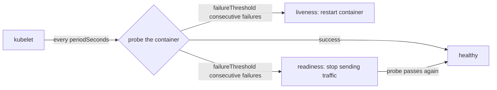
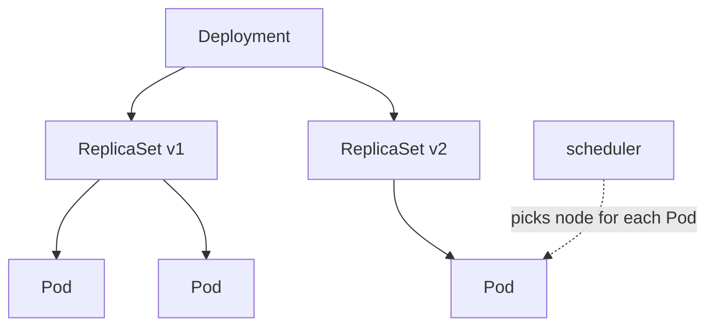
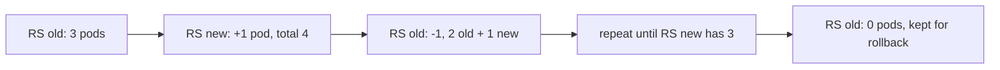

# Workloads & Scheduling (15%)

CKA domain: understand deployments, rolling updates and rollbacks; use ConfigMaps and Secrets; configure workload autoscaling; know the self-healing primitives; configure Pod admission and scheduling (limits, node affinity, etc.). Target: Kubernetes v1.37.

Video: Alta3 Research, "Kubernetes Zero to Hero" (sections below cite timestamps). Sections without a timestamp come from kubernetes.io/docs. Runnable manifests live in [`examples/02-workloads/`](../examples/02-workloads/). Cluster for experiments: `kind create cluster --name cka-study --config examples/kind-config.yaml` (1 control-plane, 2 workers).

## YAML essentials
<!-- chapter: YAML -->
[video 21:02](https://www.youtube.com/watch?v=MTHGoGUFpvE&t=1262s)

```yaml
fruits:            # list (sequence): one dash per item, order matters
  - apple
  - banana
ice_cream:         # mapping: key: value, order does not matter
  flavor: chocolate
  organic: true
  calories: 1000
  toppings:        # a list nested under a key, indented under it
    - sprinkles
    - fudge
```

- Two building blocks: lists (`-` items) and mappings (`key: value`). Everything in a manifest is a nesting of these.
- Indentation expresses ownership: whatever is indented under a key is that key's value. Use spaces, never tabs.
- A dash marks one element of a list, so `containers:`, `ports:`, `volumeMounts:` and `env:` are all lists of mappings.

## Manifest anatomy
<!-- chapter: Manifests -->
[video 24:52](https://www.youtube.com/watch?v=MTHGoGUFpvE&t=1492s)

```yaml
apiVersion: v1          # which API group/version serves this kind
kind: Pod               # case sensitive: Pod, not pod
metadata:               # name, namespace, labels, annotations
  name: nginx
spec:                   # the desired state
  containers:
    - name: nginx
      image: nginx:1.27 # a typo here = ImagePullBackOff
      ports:
        - containerPort: 80
```

- Every manifest has `apiVersion`, `kind`, `metadata`, and (for most kinds) `spec`.
- Do not write manifests from scratch. Copy one from the kubernetes.io docs (the exam allows it) or generate it: `kubectl run nginx --image=nginx --dry-run=client -o yaml`.
- `apiVersion` must be one the kind actually lives in (`v1` for Pod, `apps/v1` for Deployment). Find it with `kubectl api-resources` or `kubectl explain <kind>`.

## Making pods: get, apply, describe, delete
<!-- chapter: Making Pods -->
[video 28:55](https://www.youtube.com/watch?v=MTHGoGUFpvE&t=1735s)

```bash
kubectl get pods                         # list (current namespace only)
kubectl apply -f pod-manifest.yaml       # declarative: create or update to match the file
kubectl create -f pod-manifest.yaml      # imperative: fails if it already exists
kubectl get pods                         # READY 0/1 -> 1/1, STATUS ContainerCreating -> Running
kubectl describe pod nginx               # full detail; read the Events section at the bottom
kubectl delete -f pod-manifest.yaml      # delete by file ...
kubectl delete pod nginx                 # ... or by type and name
```

- `READY 1/1` means one of one containers passed readiness. A climbing `RESTARTS` count is a red flag.
- `kubectl describe` is the first tool to reach for on a misbehaving object: the Events list usually shows what went wrong.
- `apply` is what makes Kubernetes declarative: you hand it the desired state and it reconciles.

## Namespaces
<!-- chapter: Namespaces -->
[video 34:00](https://www.youtube.com/watch?v=MTHGoGUFpvE&t=2040s) | docs: https://kubernetes.io/docs/concepts/overview/working-with-objects/namespaces/

```bash
kubectl get namespaces                   # default, kube-system, kube-public, kube-node-lease
kubectl get pods -n kube-system          # system pods live here
kubectl get pods -A                      # all namespaces
kubectl create namespace demo            # imperative: quick and exam-friendly
kubectl apply -n demo -f pod-manifest.yaml
kubectl config set-context --current --namespace=demo   # change the default for this context
```

Two ways to place an object: `metadata.namespace: demo` in the manifest, or `-n demo` on the command line.

- `default` is simply the name of the namespace you land in when nothing else is set (the context decides).
- Namespaces separate teams and workloads, give a scope for access control, and are the unit a ResourceQuota attaches to (see [ResourceQuota and LimitRange](#resourcequota-and-limitrange)).
- Easy mistake: creating a pod in `demo`, then running `kubectl get pods` in `default` and seeing nothing.

## API versioning and deprecations
<!-- chapter: API Versioning -->
[video 38:58](https://www.youtube.com/watch?v=MTHGoGUFpvE&t=2338s)

```bash
kubectl api-resources                    # kinds, short names, apiVersion group, namespaced or not
kubectl api-versions                     # every group/version this cluster serves
kubectl explain deployment.spec.strategy # field docs straight from the cluster
```

- Upgrading a cluster upgrades its APIs. A manifest that worked yesterday can fail today with `no matches for kind "X" in version "Y"` because that version was removed.
- Fields can also change meaning, appear or disappear between versions. The Kubernetes deprecated API migration guide lists every removal per release.
- Always check what the cluster you are on serves (`kubectl api-versions`) rather than trusting an old manifest.

## Requests and limits
<!-- chapter: Requests & Limits -->
[video 44:56](https://www.youtube.com/watch?v=MTHGoGUFpvE&t=2696s) | docs: https://kubernetes.io/docs/concepts/configuration/manage-resources-containers/

Full manifest: [`pod-probes.yaml`](../examples/02-workloads/pod-probes.yaml).

```yaml
spec:
  containers:
    - name: web
      image: nginx:1.27
      resources:
        requests:          # guaranteed minimum; the scheduler places the pod using this
          cpu: 250m        # 1 core = 1000m (millicores)
          memory: 64Mi
        limits:            # hard cap
          cpu: 500m
          memory: 128Mi
```

- Set per container, not per pod.
- Requests are what the scheduler reserves on a node; limits are what the kernel enforces at runtime. A limit may not be lower than its request.
- Over the CPU limit a container is throttled; over the memory limit it is OOM-killed.
- A namespace ResourceQuota counts these numbers. Once the sum of requests (or limits) in a namespace would exceed the quota, new pods are rejected. In the video the quota acts like a bouncer at a full club: pods keep getting created until the total hits the cap, then the next one is refused.

## Probes
<!-- chapter: Probes -->
[video 51:01](https://www.youtube.com/watch?v=MTHGoGUFpvE&t=3061s) | docs: https://kubernetes.io/docs/tasks/configure-pod-container/configure-liveness-readiness-startup-probes/

Full manifest: [`pod-probes.yaml`](../examples/02-workloads/pod-probes.yaml).

```yaml
livenessProbe:             # failure -> container is killed and restarted
  httpGet:
    path: /
    port: 80
  initialDelaySeconds: 2   # wait before first probe
  periodSeconds: 5         # how often (default 10)
  timeoutSeconds: 1        # time allowed to answer (default 1)
  failureThreshold: 3      # consecutive failures before action (default 3)
readinessProbe:            # failure -> pod removed from Service endpoints, NOT restarted
  httpGet:
    path: /
    port: 80
```



- A probe belongs to a container, not the pod.
- Liveness and readiness have the same syntax. Only the consequence differs: liveness restarts, readiness withholds traffic until it recovers.
- Probe methods: `httpGet` (200-399 is success), `exec` (exit 0 is success), `tcpSocket`, `grpc`. Check `kubectl explain pod.spec.containers.livenessProbe` for the fields.
- `startupProbe` holds off liveness and readiness checks until a slow-starting container is up (budget is `failureThreshold x periodSeconds`).
- Only consecutive failures count.

## kubectl run, port-forward, exec and cp
<!-- chapter: kubectl exec & cp -->
[video 58:20](https://www.youtube.com/watch?v=MTHGoGUFpvE&t=3500s)

```bash
kubectl run demo-pod --image=nginx                 # quick pod without a manifest
kubectl port-forward pod/demo-pod 2224:80          # local 2224 -> container port 80 (blocks; Ctrl+C stops)
curl localhost:2224                                # from a second terminal

kubectl exec -it demo-pod -- sh                    # interactive shell in the container
kubectl exec demo-pod -- ls /etc/nginx             # one-off command, no shell
kubectl cp ./nginx.conf demo-pod:/etc/nginx/nginx.conf   # local -> pod
kubectl cp demo-pod:/etc/nginx/nginx.conf ./nginx.conf   # pod -> local
```

- `exec` only has the tools inside the image: no editor in a slim image.
- `kubectl cp` needs `tar` in the container image.
- Changes made inside a running container are lost when the pod is deleted or recreated, because containers are stateless. The demo is deliberately an exercise in futility: edit config in a pod, delete it, and it is all gone. The fix is to keep config outside the container (next section).
- `port-forward` is a debugging convenience, not how you expose a workload.

## ConfigMaps
<!-- chapter: ConfigMaps -->
[video 65:34](https://www.youtube.com/watch?v=MTHGoGUFpvE&t=3934s) | docs: https://kubernetes.io/docs/concepts/configuration/configmap/

```bash
printf 'Superman\nBatman\nWonder Woman\nFlash\n' > heroes.txt
kubectl create configmap dem-heroes --from-file=heroes.txt        # key = file name
kubectl create cm app-env --from-literal=LOG_LEVEL=debug          # cm = short name
kubectl describe cm dem-heroes                                    # contents show as plain text
kubectl create cm app-env --from-literal=LOG_LEVEL=debug --dry-run=client -o yaml   # generate YAML
```

```yaml
apiVersion: v1
kind: ConfigMap
metadata:
  name: heroes
data:
  heroes.txt: |
    Superman
    Batman
```

- A ConfigMap decouples configuration (files, env vars) from the image, and one ConfigMap can feed any number of pods, so a change is made in one place.
- Small plain text only (1 MiB limit). Not for big data, and not for secrets.
- Consume it as a volume (next section), as single env vars (`valueFrom.configMapKeyRef`), or all keys at once (`envFrom.configMapRef`). Env vars are read at container start and do not update; volume-mounted ConfigMaps do refresh.

## Volume mounting (ConfigMap into a pod) and subPath
<!-- chapter: Volume Mounting -->
[video 69:49](https://www.youtube.com/watch?v=MTHGoGUFpvE&t=4189s) | docs: https://kubernetes.io/docs/concepts/storage/volumes/#configmap

Full manifest: [`configmap-secret-volume.yaml`](../examples/02-workloads/configmap-secret-volume.yaml).

```yaml
spec:
  volumes:                      # pod level: declare the volume ...
    - name: heroes-vol
      configMap:                # capital M
        name: heroes
  containers:
    - name: nginx
      image: nginx:1.27
      volumeMounts:             # container level: ... then mount it
        - name: heroes-vol      # must match the volume name
          mountPath: /heroes    # directory is created if missing; one file per key
        - name: heroes-vol
          mountPath: /etc/nginx/heroes.txt
          subPath: heroes.txt   # mount ONE key as ONE file
```

```bash
kubectl exec config-demo -- cat /heroes/heroes.txt
kubectl logs config-demo       # first stop when a container crash-loops
```

- Two steps: add the volume to the pod, then mount that volume into the container at a path.
- A `mountPath` over an existing directory hides everything already in it. Mounting at `/etc/nginx` made nginx lose `nginx.conf` and crash-loop; `describe` showed only "BackOff", and `kubectl logs` showed the real error.
- `subPath` mounts a single key as a single file and leaves the other files in that directory alone.
- Docs caveat: a `subPath` mount does not receive ConfigMap updates; restart the pod to pick up changes.

## Secrets
<!-- chapter: Secrets -->
[video 78:05](https://www.youtube.com/watch?v=MTHGoGUFpvE&t=4685s) | docs: https://kubernetes.io/docs/concepts/configuration/secret/

Full manifest: [`configmap-secret-volume.yaml`](../examples/02-workloads/configmap-secret-volume.yaml).

```yaml
apiVersion: v1
kind: Secret
metadata:
  name: db-creds
type: kubernetes.io/basic-auth      # requires keys username and password
stringData:                         # write plain text; merged into data, which holds base64 strings
  username: admin
  password: s3cret
```

```bash
kubectl create secret generic app-secret --from-literal=password=s3cret
kubectl get secret db-creds -o jsonpath='{.data.password}' | base64 -d   # trivially decoded
```

- Created and used like ConfigMaps: env var via `secretKeyRef`, or a volume with `secret.secretName`.
- Built-in types include `Opaque` (default, arbitrary data), `kubernetes.io/basic-auth`, `kubernetes.io/ssh-auth`, `kubernetes.io/tls`, `kubernetes.io/dockerconfigjson`.
- Secrets are namespaced: the pod and the Secret must be in the same namespace.
- Not encrypted by default: the docs say Secrets are stored unencrypted in etcd, and anyone with API access (or etcd access) can read them. `data` values are base64 strings because that is the API's encoding, which obscures them but is not secret. Turn on encryption at rest and restrict access with RBAC (source: https://kubernetes.io/docs/concepts/configuration/secret/).

## Labels and selectors
<!-- chapter: Labels -->
[video 88:11](https://www.youtube.com/watch?v=MTHGoGUFpvE&t=5291s) | docs: https://kubernetes.io/docs/concepts/overview/working-with-objects/labels/

```bash
kubectl get pods --show-labels
kubectl label pod demo-pod awesome=sauce              # add (use =, not : at the CLI)
kubectl label pod demo-pod awesome=training           # error: already has a value
kubectl label pod demo-pod awesome=training --overwrite
kubectl label pod demo-pod awesome-                   # trailing minus removes it
kubectl get pods -L awesome                           # label value as a column
kubectl get pods -l awesome=training                  # filter with a selector
```

- Labels are arbitrary key=value pairs on any object, from pods to nodes. They are how Kubernetes groups things: Deployments, Services and NetworkPolicies find their pods by selector.
- Labels can also be edited in the manifest and re-applied.
- Pod logs live on the node under `/var/log/pods` and go away with the pod; ship logs elsewhere if you need history.

## Deployments and ReplicaSets
<!-- chapter: Deployments -->
[video 96:01](https://www.youtube.com/watch?v=MTHGoGUFpvE&t=5761s) | docs: https://kubernetes.io/docs/concepts/workloads/controllers/deployment/

Full manifest: [`deployment-rolling.yaml`](../examples/02-workloads/deployment-rolling.yaml).

```bash
kubectl create deployment demo-deploy --image=nginx          # imperative
kubectl scale deployment demo-deploy --replicas=3            # or edit replicas and re-apply
kubectl get deploy,rs,pods
kubectl delete deployment demo-deploy                        # only way to stop pods coming back (or scale to 0)
```

```yaml
apiVersion: apps/v1
kind: Deployment
metadata:
  name: web                 # metadata of the Deployment
spec:
  replicas: 3
  selector:
    matchLabels:
      app: web              # "pods with this label belong to me"
  template:                 # a pod manifest, minus name/apiVersion/kind
    metadata:
      labels:
        app: web            # MUST match the selector above
    spec:
      containers:
        - name: nginx
          image: nginx:1.26
```



- A bare pod that dies stays dead. A Deployment keeps the replica count: delete a pod and a new one replaces it.
- There are two `metadata` and two `spec` blocks: the outer pair is the Deployment, the inner pair (under `template`) is the pod. Pod names are `<deployment>-<replicaset hash>-<random>`.
- The selector and the template labels must match, or the Deployment would not recognise its own pods (the API rejects a mismatch).
- Remove the matching label from a running pod and the Deployment treats it as gone and creates a replacement; put it back and the extra pod is cleaned up to restore the count.
- Technically the Deployment creates a ReplicaSet and the ReplicaSet creates the pods. The scheduler picks the node. A Deployment adds version control (rollout and rollback) on top of a ReplicaSet.
- Changing the pod template makes the Deployment create a new ReplicaSet and shift pods over gradually (rolling update, the default). Detail in the next section.

## Rollout, rolling update and rollback
<!-- chapter: Deployments -->
Docs: https://kubernetes.io/docs/concepts/workloads/controllers/deployment/ and video context [video 96:01](https://www.youtube.com/watch?v=MTHGoGUFpvE&t=5761s)

```bash
kubectl set image deployment/web <container-name>=<image>   # here the container is named nginx
kubectl annotate deployment/web kubernetes.io/change-cause="bump to 1.27"   # shows in history
kubectl rollout status deployment/web
kubectl rollout history deployment/web
kubectl rollout history deployment/web --revision=2
kubectl rollout undo deployment/web                          # previous revision
kubectl rollout undo deployment/web --to-revision=1
kubectl rollout pause deployment/web                         # batch several edits ...
kubectl rollout resume deployment/web                        # ... then roll them out together
kubectl rollout restart deployment/web                       # re-roll pods with no spec change
```

```yaml
spec:
  strategy:
    type: RollingUpdate        # default; the other option is Recreate (kill all, then start)
    rollingUpdate:
      maxSurge: 1              # extra pods allowed above replicas (default 25%)
      maxUnavailable: 0        # pods allowed to be down (default 25%); both cannot be 0
  revisionHistoryLimit: 10     # old ReplicaSets kept for rollback
  minReadySeconds: 0
  progressDeadlineSeconds: 600
```



- A rolling update never drops below the desired count (with `maxUnavailable: 0`): surge one new pod, remove one old pod, repeat.
- A bad image does not take the app down: the new ReplicaSet's pod sits in `ErrImagePull` while the old pods keep serving. The rollout stalls, and `rollout undo` reverts it. (Checked on kind v1.37: after a bad `set image`, 3 old pods stayed Running and `rollout undo` restored the previous ReplicaSet.)
- The `change-cause` annotation is copied to each new revision, so it must be updated before each change or history shows a stale cause.
- `kubectl rollout undo` creates a new revision number; it does not rewind the counter.
- `--record` is deprecated; use the annotation.

## DaemonSet
<!-- gap -->
Docs: https://kubernetes.io/docs/concepts/workloads/controllers/daemonset/

Full manifest: [`daemonset.yaml`](../examples/02-workloads/daemonset.yaml).

```bash
kubectl apply -f examples/02-workloads/daemonset.yaml
kubectl get ds node-agent                 # DESIRED/CURRENT/READY follow the node count
kubectl get pods -l name=node-agent -o wide   # one per node
```

- Runs one pod on every node (or every node matching `nodeSelector`/`affinity` in the template). New nodes get a pod automatically; removed nodes lose theirs.
- Use for node-level agents: log collectors, monitoring agents, CNI and kube-proxy.
- Control-plane nodes are tainted `node-role.kubernetes.io/control-plane:NoSchedule`, so add a toleration to run there (the example does).
- `.spec.selector` must match the template labels and cannot be changed after creation.
- No `replicas` field. Update strategy is `RollingUpdate` (default) or `OnDelete`.

## StatefulSet
<!-- gap -->
Docs: https://kubernetes.io/docs/concepts/workloads/controllers/statefulset/

```yaml
apiVersion: v1
kind: Service
metadata:
  name: nginx
spec:
  clusterIP: None            # headless Service for stable per-pod DNS
  selector:
    app: nginx
  ports:
    - port: 80
      name: web
---
apiVersion: apps/v1
kind: StatefulSet
metadata:
  name: web
spec:
  serviceName: nginx         # must name the headless Service
  replicas: 3
  selector:
    matchLabels:
      app: nginx
  template:
    metadata:
      labels:
        app: nginx
    spec:
      containers:
        - name: nginx
          image: registry.k8s.io/nginx-slim:0.24
          volumeMounts:
            - name: www
              mountPath: /usr/share/nginx/html
  volumeClaimTemplates:      # one PVC per pod: www-web-0, www-web-1, ...
    - metadata:
        name: www
      spec:
        accessModes: ["ReadWriteOnce"]
        resources:
          requests:
            storage: 1Gi
```

- For workloads that need stable identity: pods are named `web-0`, `web-1`, ... and keep their name, DNS name and storage across rescheduling. Not interchangeable like Deployment pods.
- Pods are started in order (`podManagementPolicy: OrderedReady`, default) and updated in reverse ordinal order.
- You must create the headless Service yourself.
- Deleting or scaling down does not delete the PVCs; delete them separately. To stop pods in order, scale to 0 before deleting.
- Storage is covered in the storage note; a default StorageClass is needed for the claim to bind (kind ships `standard`).

## Jobs and CronJobs
<!-- gap -->
Docs: https://kubernetes.io/docs/concepts/workloads/controllers/job/ and https://kubernetes.io/docs/concepts/workloads/controllers/cron-jobs/

Full manifest: [`cronjob.yaml`](../examples/02-workloads/cronjob.yaml).

```bash
kubectl create job pi --image=perl:5.34.0 -- perl -Mbignum=bpi -wle 'print bpi(200)'
kubectl logs job/pi
kubectl create cronjob hello --image=busybox:1.36 --schedule="*/1 * * * *" -- date
kubectl get cronjob,job,pods
kubectl create job manual-run --from=cronjob/hello      # trigger a CronJob now
```

```yaml
kind: Job
spec:
  completions: 5           # total successful pods wanted (default 1)
  parallelism: 2           # pods at once (default 1)
  backoffLimit: 4          # retries before the Job is marked failed
  ttlSecondsAfterFinished: 100
  template:
    spec:
      restartPolicy: Never # Job pods must use Never or OnFailure
```

- A Job runs pods to completion; a CronJob creates Jobs on a cron schedule (`min hour day-of-month month day-of-week`).
- `concurrencyPolicy` (CronJob): `Allow` (default), `Forbid` (skip if the previous run is still going), `Replace`.
- `startingDeadlineSeconds` bounds how late a missed run may still start. `successfulJobsHistoryLimit`/`failedJobsHistoryLimit` control how many finished Jobs are kept.

## Horizontal Pod Autoscaler
<!-- gap -->
Docs: https://kubernetes.io/docs/tasks/run-application/horizontal-pod-autoscale/

Full manifest: [`hpa.yaml`](../examples/02-workloads/hpa.yaml).

```bash
kubectl autoscale deployment web --min=2 --max=6 --cpu=50%
kubectl get hpa web --watch
kubectl describe hpa web
```

- Scales a Deployment/StatefulSet between `minReplicas` and `maxReplicas` toward a target metric. Formula: `desired = ceil(current replicas x current metric / target metric)`.
- Needs metrics-server (a `metrics.k8s.io` provider) installed; on a plain kind cluster `kubectl top` returns `Metrics API not available` until you add it.
- For CPU/memory utilisation targets the pod must declare resource requests, or the HPA cannot compute a percentage.
- `behavior.scaleDown.stabilizationWindowSeconds` (default 300) prevents flapping.
- The [kubectl autoscale reference](https://kubernetes.io/docs/reference/kubectl/generated/kubectl_autoscale/) lists `--cpu` (a percentage means average utilisation, a quantity such as `500m` means average value) and no `--cpu-percent`; older material uses `--cpu-percent`, so write `--cpu=50%`.

## ResourceQuota and LimitRange
<!-- gap -->
Docs: https://kubernetes.io/docs/concepts/policy/resource-quotas/ and https://kubernetes.io/docs/concepts/policy/limit-range/

Full manifest: [`quota-limitrange.yaml`](../examples/02-workloads/quota-limitrange.yaml). The video introduces the quota in [Namespaces](#namespaces) and [Requests and limits](#requests-and-limits).

```bash
kubectl create namespace demo
kubectl apply -n demo -f examples/02-workloads/quota-limitrange.yaml
kubectl create quota q --hard=requests.cpu=1,limits.cpu=2,pods=10 -n demo --dry-run=client -o yaml
kubectl describe quota demo-quota -n demo     # Used vs Hard
kubectl get limitrange -n demo
```

```yaml
kind: ResourceQuota
spec:
  hard:
    requests.cpu: "1"
    limits.memory: 2Gi
    pods: "10"
---
kind: LimitRange
spec:
  limits:
    - type: Container
      defaultRequest: { cpu: 100m, memory: 64Mi }   # injected when a container sets none
      default:        { cpu: 200m, memory: 128Mi }  # default limit
```

- ResourceQuota caps the total a namespace can use (compute, object counts). Exceeding it returns `403 Forbidden: exceeded quota` at create time. Checked on kind v1.37: with `requests.cpu: 1`, a first pod requesting 600m was admitted and a second 600m pod was refused.
- When a quota covers cpu/memory, every pod must set requests/limits (or get them from a LimitRange); otherwise it is rejected.
- LimitRange sets per-container defaults and min/max in a namespace. It is applied at admission, so it only affects pods created after it exists.
- A Deployment that violates a quota is still created; its ReplicaSet just cannot create pods. Check `kubectl describe rs`.

## nodeSelector, node affinity and nodeName
<!-- gap -->
Docs: https://kubernetes.io/docs/concepts/scheduling-eviction/assign-pod-node/

Full manifest: [`taint-toleration.yaml`](../examples/02-workloads/taint-toleration.yaml).

```bash
kubectl label nodes cka-study-worker disktype=ssd
kubectl get nodes --show-labels
kubectl get pod affinity-demo -o wide        # NODE column shows where it landed
```

```yaml
spec:
  nodeSelector:                 # simplest: all labels must match
    disktype: ssd
---
spec:
  affinity:
    nodeAffinity:
      requiredDuringSchedulingIgnoredDuringExecution:    # hard rule
        nodeSelectorTerms:
          - matchExpressions:
              - key: disktype
                operator: In            # In, NotIn, Exists, DoesNotExist, Gt, Lt
                values: ["ssd"]
      preferredDuringSchedulingIgnoredDuringExecution:   # soft rule
        - weight: 1
          preference:
            matchExpressions:
              - key: kubernetes.io/hostname
                operator: NotIn
                values: ["cka-study-worker2"]
---
spec:
  nodeName: cka-study-worker    # bypasses the scheduler entirely
```

- `nodeSelector` is exact label match. Affinity adds operators and soft preferences.
- `IgnoredDuringExecution` means a pod already running is not moved if node labels change later.
- A pod whose required rules match no node stays `Pending`; `kubectl describe pod` shows `FailedScheduling` in Events.
- `nodeName` skips scheduling (and so ignores taints and resource fit). Useful to know; rarely the right tool.

## Taints and tolerations
<!-- gap -->
Docs: https://kubernetes.io/docs/concepts/scheduling-eviction/taint-and-toleration/

Full manifest: [`taint-toleration.yaml`](../examples/02-workloads/taint-toleration.yaml).

```bash
kubectl taint nodes cka-study-worker dedicated=batch:NoSchedule     # add
kubectl taint nodes cka-study-worker dedicated=batch:NoSchedule-    # remove (trailing minus)
kubectl describe node cka-study-worker | grep -i taint
```

```yaml
tolerations:
  - key: dedicated
    operator: Equal          # or Exists (then omit value)
    value: batch
    effect: NoSchedule
```

- A taint on a node repels pods; a toleration on a pod lets it onto the tainted node. Effects: `NoSchedule` (no new pods), `PreferNoSchedule` (soft), `NoExecute` (also evicts running pods; `tolerationSeconds` delays eviction).
- A toleration only permits; it does not attract. To dedicate a node, taint it and also use a nodeSelector/affinity on the pods.
- The control-plane node carries `node-role.kubernetes.io/control-plane:NoSchedule` by default; that is why ordinary pods land on workers only.

## PriorityClass and preemption
<!-- gap -->
Docs: https://kubernetes.io/docs/concepts/scheduling-eviction/pod-priority-preemption/

Full manifest: [`priorityclass.yaml`](../examples/02-workloads/priorityclass.yaml).

```yaml
apiVersion: scheduling.k8s.io/v1
kind: PriorityClass          # cluster-scoped
metadata:
  name: high-priority
value: 1000000               # any 32-bit integer <= 1 billion
globalDefault: false         # at most one class may be true; used by Pods with no priorityClassName
preemptionPolicy: Never      # optional; default PreemptLowerPriority
description: "Use for important Pods only."
---
apiVersion: v1
kind: Pod
metadata:
  name: priority-demo
spec:
  priorityClassName: high-priority   # the class must exist, or the Pod is rejected
  containers:
    - name: nginx
      image: nginx:1.27
```

```bash
kubectl get priorityclass
kubectl get pod priority-demo -o jsonpath='{.spec.priority} {.spec.priorityClassName} {.spec.preemptionPolicy}{"\n"}'
```

- If a pending Pod fits on no node, the scheduler looks for a node where evicting one or more lower-priority Pods would let it fit, evicts them (they get their graceful termination period), and records the node in the pending Pod's `status.nominatedNodeName`. The Pod is not guaranteed to land there.
- `preemptionPolicy: Never` queues the Pod ahead of lower-priority Pods but it cannot preempt anyone (it can still be preempted by higher-priority Pods).
- Built-in classes: `system-cluster-critical` (2000000000) and `system-node-critical` (2000001000). User class names cannot start with `system-`.
- PodDisruptionBudgets are honoured only best-effort during preemption; there is no cross-node preemption.
- Checked on kind v1.37: a Pod with `priorityClassName: high-priority` got `spec.priority` 1000000 and policy `PreemptLowerPriority`. Preemption itself was not triggered live.

## Inter-pod affinity and anti-affinity
<!-- gap -->
Docs: https://kubernetes.io/docs/concepts/scheduling-eviction/assign-pod-node/#inter-pod-affinity-and-anti-affinity

Full manifest: [`pod-anti-affinity.yaml`](../examples/02-workloads/pod-anti-affinity.yaml).

```yaml
spec:
  affinity:
    podAntiAffinity:                    # keep away from Pods matching the selector
      requiredDuringSchedulingIgnoredDuringExecution:
        - labelSelector:
            matchExpressions:
              - key: app
                operator: In
                values: ["spread-web"]
          topologyKey: kubernetes.io/hostname   # "same domain" = same node
    podAffinity:                        # co-locate with Pods matching the selector
      preferredDuringSchedulingIgnoredDuringExecution:
        - weight: 100
          podAffinityTerm:              # soft rules wrap the term and add a weight
            labelSelector:
              matchExpressions:
                - key: security
                  operator: In
                  values: ["S1"]
            topologyKey: topology.kubernetes.io/zone
```

- Node affinity looks at node labels; this looks at labels of Pods already running in a topology domain. `topologyKey` is the node-label key that defines the domain (`kubernetes.io/hostname` = per node, `topology.kubernetes.io/zone` = per zone).
- Operators: `In`, `NotIn`, `Exists`, `DoesNotExist` (`Gt`/`Lt` are node-affinity only).
- The selector matches Pods in the rule's own namespace unless `namespaces` or `namespaceSelector` is set.
- A required anti-affinity rule is limited to `topologyKey: kubernetes.io/hostname` by the `LimitPodHardAntiAffinityTopology` admission controller. An empty `topologyKey` is not allowed.
- Docs warn that these rules are costly in large clusters (not recommended beyond several hundred nodes), and that every node must carry the `topologyKey` label.
- Checked on kind v1.37 (2 workers): the 2-replica Deployment with required hostname anti-affinity put one Pod on each worker; the `with-pod-affinity` Pod, which requires co-location with `app=spread-web`, was scheduled and Running.

## Topology spread constraints
<!-- gap -->
Docs: https://kubernetes.io/docs/concepts/scheduling-eviction/topology-spread-constraints/

Full manifest: [`topology-spread.yaml`](../examples/02-workloads/topology-spread.yaml).

```yaml
spec:
  topologySpreadConstraints:
    - maxSkew: 1                           # max allowed difference between domains
      topologyKey: kubernetes.io/hostname  # a domain = one distinct value of this node label
      whenUnsatisfiable: DoNotSchedule     # default; ScheduleAnyway only prefers a balanced node
      nodeTaintsPolicy: Honor              # default (null) is Ignore
      labelSelector:
        matchLabels:
          app: spread-demo                 # which Pods are counted
```

- With `DoNotSchedule`, `maxSkew` is the maximum permitted difference between the matching-Pod count in the target domain and the global minimum. With `ScheduleAnyway` the scheduler just prefers nodes that reduce skew.
- Optional `minDomains` (only with `DoNotSchedule`): below that many eligible domains the global minimum is treated as 0.
- One constraint per `topologyKey` and `whenUnsatisfiable` pair.
- `nodeTaintsPolicy` null behaves as `Ignore`: tainted nodes still count as domains. Checked on kind v1.37 (2 workers plus a tainted control plane): with the default, a 4-replica Deployment left 2 Pods `Pending` (the empty control-plane domain kept the global minimum at 0); with `nodeTaintsPolicy: Honor` the 4 Pods ran 2 per worker.

## Init containers
<!-- gap -->
Docs: https://kubernetes.io/docs/concepts/workloads/pods/init-containers/

Full manifest: [`init-container.yaml`](../examples/02-workloads/init-container.yaml).

```yaml
spec:
  initContainers:               # list, run in order
    - name: init-wait
      image: busybox:1.28
      command: ['sh', '-c', 'echo preparing && sleep 5']
    - name: init-file
      image: busybox:1.28
      command: ['sh', '-c', 'echo ready > /work/ready.txt']
      volumeMounts: [{name: work, mountPath: /work}]
  containers:
    - name: app
      image: busybox:1.28
      command: ['sh', '-c', 'cat /work/ready.txt && sleep 3600']
      volumeMounts: [{name: work, mountPath: /work}]
  volumes:
    - name: work
      emptyDir: {}
```

```bash
kubectl get pod init-demo                       # STATUS Init:0/2 while init containers run (seen on kind), then Running
kubectl logs init-demo -c init-file             # logs of one init container
kubectl get pod init-demo -o jsonpath='{.status.initContainerStatuses[*].state}'
```

- Each init container runs to completion, one after another, before the app containers start. A failing one is restarted until it succeeds, unless the Pod's `restartPolicy` is `Never`, in which case the Pod fails.
- Use them for setup that must finish first: waiting for a Service (`until nslookup ...`), preparing a shared volume.
- Regular init containers do not support `lifecycle`, `livenessProbe`, `readinessProbe` or `startupProbe`. Resources, volumes and security settings work as in app containers.
- Status is in `.status.initContainerStatuses`. Checked on kind v1.37: both init containers ended `Completed` (exit 0) and the app printed `ready`.

## Native sidecar containers
<!-- gap -->
Docs: https://kubernetes.io/docs/concepts/workloads/pods/sidecar-containers/

Full manifest: [`sidecar.yaml`](../examples/02-workloads/sidecar.yaml).

```yaml
spec:
  containers:
    - name: myapp
      image: alpine:latest
      command: ['sh', '-c', 'while true; do echo "logging" >> /opt/logs.txt; sleep 1; done']
      volumeMounts: [{name: data, mountPath: /opt}]
  initContainers:
    - name: logshipper
      image: alpine:latest
      restartPolicy: Always       # this line turns an init container into a sidecar
      command: ['sh', '-c', 'tail -F /opt/logs.txt']
      volumeMounts: [{name: data, mountPath: /opt}]
  volumes:
    - name: data
      emptyDir: {}
```

```bash
kubectl get pods -l app=sidecar-demo           # READY 2/2: the sidecar counts as a container
kubectl logs deploy/sidecar-demo -c logshipper
```

- A sidecar is declared under `initContainers` with `restartPolicy: Always`. It starts in order like an init container, but the next init container (and then the app containers) start once it has started, and it keeps running for the life of the Pod.
- On termination the kubelet waits until the main containers have stopped, then shuts sidecars down in reverse order of the spec.
- Sidecars support probes; a `readinessProbe` on one feeds the Pod's Ready state.
- In a Job, a sidecar does not stop the Job from completing once the main container finishes.
- Stable since v1.33 (first available v1.28).
- Checked on kind v1.37: Pod `2/2 Running`, `initContainers[0].restartPolicy` read back as `Always`, and the sidecar's logs showed `logging`.

## Static pods and the scheduler
<!-- gap -->
Docs: https://kubernetes.io/docs/tasks/configure-pod-container/static-pod/

```bash
# on the node (kind: docker exec -it cka-study-control-plane bash)
grep staticPodPath /var/lib/kubelet/config.yaml   # staticPodPath: /etc/kubernetes/manifests
ls /etc/kubernetes/manifests                       # etcd, kube-apiserver, kube-controller-manager, kube-scheduler
kubectl get pods -n kube-system                    # mirror pods: name ends with the node name
```

- A static pod is run directly by the kubelet from a manifest file in `staticPodPath`; the API server only holds a read-only mirror pod. Drop a file in to create it, delete the file to remove it.
- `kubectl delete pod` on a mirror pod does nothing lasting; the kubelet recreates it.
- kubeadm runs the control-plane components as static pods this way (confirmed on the kind control-plane node: etcd, apiserver, controller-manager, scheduler manifests).
- The scheduler picks a node for pods without `nodeName` by filtering (resource fit, taints, selectors) then scoring nodes. Static pods and pods with `nodeName` never go through it.

## Gotchas

Sources: the sections above, each gotcha from the page that section cites: https://kubernetes.io/docs/concepts/configuration/configmap/ , https://kubernetes.io/docs/concepts/configuration/secret/ , https://kubernetes.io/docs/concepts/workloads/controllers/deployment/ , https://kubernetes.io/docs/concepts/policy/resource-quotas/ , https://kubernetes.io/docs/concepts/workloads/controllers/job/ , https://kubernetes.io/docs/tasks/run-application/horizontal-pod-autoscale/ , https://kubernetes.io/docs/concepts/scheduling-eviction/pod-priority-preemption/ , https://kubernetes.io/docs/concepts/scheduling-eviction/topology-spread-constraints/ , https://kubernetes.io/docs/concepts/workloads/pods/init-containers/ , https://kubernetes.io/docs/concepts/workloads/pods/sidecar-containers/ .

- `kind` and `apiVersion` are case sensitive and must be a real pair; `kubectl api-resources` tells you the right one.
- `kubectl get pods` only shows the current namespace; a pod "missing" is usually in another namespace (`-A` to check).
- Requests and limits (and probes) go on each container, not on the pod.
- A limit below the request is rejected. Over the memory limit the container is OOM-killed; over the CPU limit it is throttled.
- Liveness restarts containers, readiness only removes traffic. A too-tight liveness probe can cause a restart loop.
- `mountPath` over an existing directory hides its contents; use `subPath` to add one file. A `subPath` mount does not receive ConfigMap updates.
- ConfigMap env vars are fixed at container start; restart the pod to pick up changes.
- ConfigMap key names are case-sensitive and the volume field is `configMap` (capital M); ConfigMaps and Secrets must be in the pod's namespace.
- Secrets are stored unencrypted in etcd by default; base64 is only the API encoding and `base64 -d` reveals them.
- At the CLI labels use `key=value` (no colon); changing an existing key needs `--overwrite`; `key-` removes.
- Deployment selector and template labels must match. Stripping a pod's label makes the Deployment spawn a replacement.
- `kubectl rollout undo` reverts the template to an earlier revision as a new revision; the `change-cause` annotation carries forward until you change it.
- A DaemonSet needs a toleration to run on control-plane nodes; a toleration alone does not pull pods onto a tainted node.
- Quota with cpu/memory requires requests/limits on every pod (or a LimitRange default); a Deployment over quota is created but its pods are not.
- HPA needs metrics-server and pod resource requests; without them it shows `<unknown>`.
- Job pods need `restartPolicy: Never` or `OnFailure`, never `Always`.
- Deleting a mirror (static) pod with kubectl does not remove it; delete the manifest file on the node.
- A Pod naming a `priorityClassName` that does not exist is rejected; `preemptionPolicy: Never` queues first but never evicts.
- Topology spread counts tainted nodes as domains unless `nodeTaintsPolicy: Honor`, so Pods can stay `Pending` on a cluster with a tainted control plane.
- A sidecar is an init container with `restartPolicy: Always`; a plain init container must finish before the app starts.
