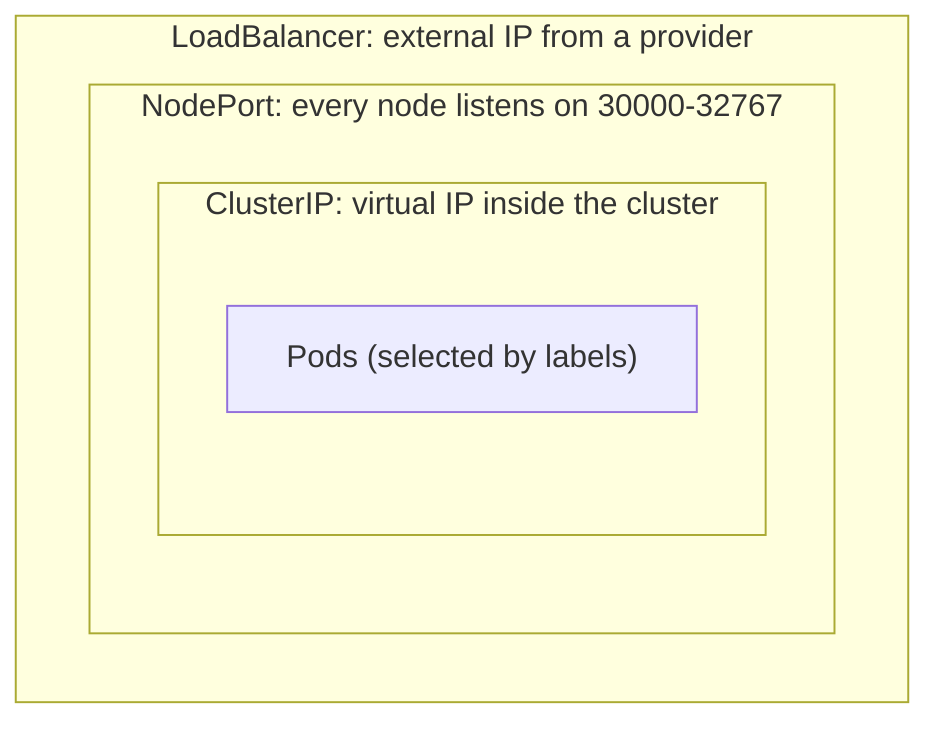
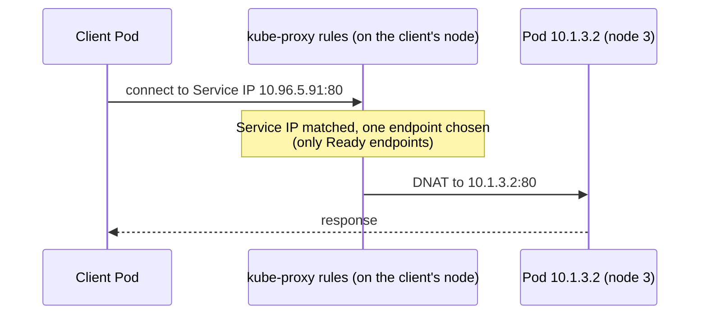
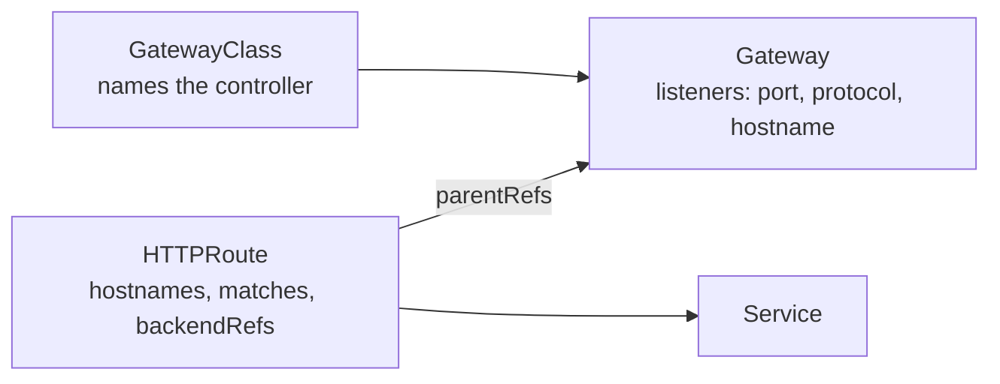

# Services & Networking (20%)

CKA domain: understand host networking and Pod connectivity; define and enforce Network Policies; use ClusterIP, NodePort and LoadBalancer Services and EndpointSlices; use the Gateway API and Ingress controllers/resources; understand and use CoreDNS; know CNI as an extension interface. Target: Kubernetes v1.37.

Video: Alta3 Research, "Kubernetes Zero to Hero" (sections below cite timestamps). Sections without a timestamp come from kubernetes.io/docs. Runnable manifests live in [`examples/03-networking/`](../examples/03-networking/). Cluster for experiments: `kind create cluster --name cka-study --config examples/kind-config.yaml`.

## Service basics: a stable IP in front of changing Pods
<!-- chapter: Service Basics -->
[video 132:40](https://www.youtube.com/watch?v=MTHGoGUFpvE&t=7960s) | docs: https://kubernetes.io/docs/concepts/services-networking/service/

```bash
kubectl create deployment demo-deploy --image=nginx --replicas=3 --port=80
kubectl expose deployment demo-deploy --port=80 --target-port=80   # creates a ClusterIP Service
kubectl get pods -o wide                                           # every Pod has its own IP
kubectl describe svc demo-deploy                                   # Endpoints: the Pod IPs, tracked live
kubectl scale deployment demo-deploy --replicas=1                  # Endpoints shrink; Service IP unchanged
```

- Pod IPs change whenever a Pod is rebuilt (even on another node), so nothing should hard-code them. The Service IP stays the same for the life of the Service.
- The Service finds its Pods through a label `selector`, the same mechanism Deployments and NetworkPolicies use. The control plane keeps the matching Pod IPs in EndpointSlices (see below).
- `kubectl expose` is the fast route; the manifest equivalent is in `examples/03-networking/clusterip.yaml`.
- Test from inside the cluster with a throwaway Pod: `kubectl run client --image=busybox --restart=Never -- sleep 3600`, then `kubectl exec client -- wget -qO- demo-deploy`. The Service name resolves via cluster DNS.
- By default every Pod can reach every other Pod. Restricting that is the job of NetworkPolicy.

## Service types: each layer builds on the previous
<!-- chapter: LoadBalancer -->
[video 160:02](https://www.youtube.com/watch?v=MTHGoGUFpvE&t=9602s) | docs: https://kubernetes.io/docs/concepts/services-networking/service/



| Type | Reachable from | Needs |
|---|---|---|
| `ClusterIP` (default) | inside the cluster | nothing |
| `NodePort` | `<any node IP>:<nodePort>` | node IPs reachable by the client |
| `LoadBalancer` | provider-assigned external IP | a load balancer implementation |

- Creating a NodePort also creates a ClusterIP; a LoadBalancer creates both.
- Kubernetes ships no load balancer. Cloud providers (or something like MetalLB) supply one; without it `EXTERNAL-IP` stays `<pending>`.
- Other kinds from docs: headless (`clusterIP: None`, DNS returns Pod IPs, no virtual IP) and `ExternalName` (a DNS CNAME, no proxying).

## NetworkPolicy anatomy
<!-- chapter: Network Policies -->
[video 139:40](https://www.youtube.com/watch?v=MTHGoGUFpvE&t=8380s) | docs: https://kubernetes.io/docs/concepts/services-networking/network-policies/

```yaml
apiVersion: networking.k8s.io/v1
kind: NetworkPolicy
metadata:
  name: allow-frontend-from-myproject
  namespace: default          # policies are namespaced; they govern Pods in this namespace
spec:
  podSelector:                # WHO is being protected
    matchLabels:
      role: db
  policyTypes: [Ingress, Egress]
  ingress:
    - from:                   # allowed sources (any one `from` item may match)
        - namespaceSelector:
            matchLabels: {project: myproject}
          podSelector:
            matchLabels: {role: frontend}
        - ipBlock:
            cidr: 172.17.0.0/16
            except: [172.17.1.0/24]
      ports:
        - {protocol: TCP, port: 6379}
  egress:
    - to:
        - ipBlock: {cidr: 10.0.0.0/24}
      ports:
        - {protocol: TCP, port: 5978}
```

- Think of it as a strict parent: `podSelector` picks the Pods it governs, `policyTypes` says which directions, the rules list what is still allowed.
- Once a Pod is selected for a direction, anything not explicitly allowed in that direction is denied. Policies are additive: the union of all policies selecting a Pod applies.
- Three kinds of peer: `podSelector`, `namespaceSelector` (matches labels on the namespace object), `ipBlock` (CIDR with optional `except`).
- Placement matters. In the same list item, `namespaceSelector` + `podSelector` is AND (docs: both must match). As separate `-` items they are OR. One missing/extra dash flips the meaning.
- Every namespace carries the label `kubernetes.io/metadata.name: <name>`, handy for `namespaceSelector` without labelling anything yourself.
- A connection needs both sides to allow it: the source's egress policy and the destination's ingress policy.
- Full example: `examples/03-networking/networkpolicy-allow-namespace.yaml`.

## Default deny, then allow
<!-- chapter: Service Port vs TargetPort -->
[video 146:29](https://www.youtube.com/watch?v=MTHGoGUFpvE&t=8789s) | docs: https://kubernetes.io/docs/concepts/services-networking/network-policies/

(In the video this demo sits at the start of the "Port vs TargetPort" chapter marker.)

```yaml
# default deny: empty podSelector = every Pod in the namespace, no rules = nothing allowed
apiVersion: networking.k8s.io/v1
kind: NetworkPolicy
metadata:
  name: default-deny-ingress
spec:
  podSelector: {}
  policyTypes: [Ingress]
---
# then allow only Pods labelled run=client into the nginx Pods
apiVersion: networking.k8s.io/v1
kind: NetworkPolicy
metadata:
  name: allow-client-to-demo
spec:
  podSelector:
    matchLabels: {app: demo-deploy}
  policyTypes: [Ingress]
  ingress:
    - from:
        - podSelector:
            matchLabels: {run: client}
```

```bash
kubectl apply -f examples/03-networking/networkpolicy-default-deny.yaml
kubectl exec client -- wget -qO- -T4 demo-deploy     # works (label run=client)
kubectl exec other  -- wget -qO- -T4 demo-deploy     # hangs / times out: denied
```

- Denied traffic does not error, it hangs until the timeout. Always use `-T`/`--max-time` when testing.
- Workflow shown: first prove connectivity, apply default deny, watch it break, then narrow `podSelector` to the target Pods and allow the one source label.
- Find the labels to use with `kubectl get pods --show-labels`. `kubectl run client` gives the Pod `run=client` automatically.
- Default deny for egress is the same with `policyTypes: [Egress]`. Doing that also blocks DNS, so add a rule allowing UDP/TCP 53 to CoreDNS (`k8s-app: kube-dns` in `kube-system`), as in `networkpolicy-allow-namespace.yaml`.

## ClusterIP, port vs targetPort
<!-- chapter: ClusterIP -->
[video 150:31](https://www.youtube.com/watch?v=MTHGoGUFpvE&t=9031s) | docs: https://kubernetes.io/docs/concepts/services-networking/service/

```yaml
apiVersion: v1
kind: Service
metadata:
  name: demo-deploy
spec:
  type: ClusterIP
  selector:
    app: demo-deploy        # Pods with this label receive the traffic
  ports:
    - name: http
      port: 80              # port on the Service (clusterIP:80)
      targetPort: http      # port on the Pod: a number, or the container port's name
    - name: admin           # a Service can map several ports, even to different containers in a Pod
      port: 4444
      targetPort: 8888
```

- `port` is where clients knock on the Service; `targetPort` is where the container listens. If `targetPort` is omitted it defaults to `port`.
- Multi-container Pods: one Service can expose several containers by listing several ports (`4444` -> `8888` above). With more than one port, each needs a `name`.
- Naming the container port (`ports: [{name: http, containerPort: 80}]`) and using `targetPort: http` lets Pods change numbers without touching the Service.
- Services only route to Pods that are Ready; failing readiness probes drop the Pod from the endpoints.

## kube-proxy: how a Service IP reaches a Pod
<!-- chapter: ClusterIP -->
[video 153:38](https://www.youtube.com/watch?v=MTHGoGUFpvE&t=9218s) | docs: https://kubernetes.io/docs/reference/networking/virtual-ips/



- A `kube-proxy` runs on every node and programs that node's packet-forwarding rules (iptables by default) from the Service/EndpointSlice data. Each node ends up with the same table, so a Service works identically from anywhere.
- The Service IP is virtual and the rules rewrite (DNAT) the destination to a Pod IP; the client IP is not rewritten for ClusterIP traffic.

## Backend selection is cluster-wide
<!-- chapter: NodePort -->
[video 157:00](https://www.youtube.com/watch?v=MTHGoGUFpvE&t=9420s) | docs: https://kubernetes.io/docs/reference/networking/virtual-ips/

- Which Pod is chosen does not depend on locality. The video describes round-robin; the docs say iptables mode picks a backend at random by default. Either way, do not rely on ordering; use session affinity if you need stickiness.
- Only healthy (Ready) endpoints are used, so a Pod still in `ContainerCreating` or erroring is skipped.
- Every node's kube-proxy holds the same table, whether the cluster has 1 node or 50, so a client Pod can be sent to a replica on a different node and that is fine.
- The same table is how a NodePort or load-balancer request lands on a Pod on a different node.

## NodePort
<!-- chapter: NodePort Demo -->
[video 161:14](https://www.youtube.com/watch?v=MTHGoGUFpvE&t=9674s) | docs: https://kubernetes.io/docs/concepts/services-networking/service/

```bash
kubectl apply -f examples/03-networking/nodeport.yaml
kubectl get svc demo-deploy-nodeport        # PORT(S) 80:30080/TCP
curl <any-node-ip>:30080                    # kube-proxy forwards to some Pod, wherever it runs
```

```yaml
spec:
  type: NodePort
  ports:
    - port: 80
      targetPort: http
      nodePort: 30080      # optional; auto-assigned if omitted
```

- Simplest way to let clients outside the cluster in without `kubectl`: any node IP plus the node port reaches the Service.
- Default range is 30000-32767 (kube-apiserver `--service-node-port-range`).
- Hitting node 3 can land on a Pod on node 2; that is normal. With 50 nodes and one Pod you could not otherwise guess the right node.
- Port-forward is the debugging alternative: `kubectl port-forward pod/<name> 2224:80`, then browse `localhost:2224`.

## LoadBalancer
<!-- chapter: NodePort Demo -->
[video 163:04](https://www.youtube.com/watch?v=MTHGoGUFpvE&t=9784s) | docs: https://kubernetes.io/docs/concepts/services-networking/service/

```yaml
spec:
  type: LoadBalancer
  selector: {app: demo-deploy}
  ports:
    - port: 80
      targetPort: http
```

- Still built on NodePorts: an external machine with a public IP takes the traffic and picks a node (and so a Pod) with its own, smarter balancing instead of kube-proxy's plain selection.
- In a cloud, the provider provisions it for you. On bare metal or kind you must supply one; otherwise `EXTERNAL-IP` shows `<pending>` forever (verified on the kind cluster).
- The video's chapter ends mid-demo at the promo; the live NodePort walkthrough is covered by the section above.

## Ingress and Ingress controllers
<!-- gap -->
Source: https://kubernetes.io/docs/concepts/services-networking/ingress/

```yaml
apiVersion: networking.k8s.io/v1
kind: Ingress
metadata:
  name: demo-ingress
spec:
  ingressClassName: nginx        # picks the controller
  rules:
    - host: demo.example.com
      http:
        paths:
          - path: /
            pathType: Prefix     # Prefix | Exact | ImplementationSpecific
            backend:
              service:
                name: demo-deploy
                port:
                  number: 80
  # tls: [{hosts: [demo.example.com], secretName: demo-tls}]   # kubernetes.io/tls Secret
```

```bash
kubectl get ingressclass
kubectl create ingress demo-ingress --class=nginx --rule="demo.example.com/*=demo-deploy:80"   # flags: https://kubernetes.io/docs/reference/kubectl/generated/kubectl_create/kubectl_create_ingress/
kubectl describe ingress demo-ingress
```

- Ingress routes HTTP(S) by host and path to Services, so one entry point serves many Services. The object alone does nothing: "Only creating an Ingress resource has no effect." An Ingress controller (ingress-nginx, Traefik, ...) must be installed and watch it.
- `ingressClassName` must match an existing IngressClass; without it a default IngressClass is used if one is marked default.
- Docs state the Ingress API is frozen and recommend Gateway API for new work. It is GA and not being removed, and it is still on the CKA curriculum.
- The backend is a Service, so selectors and Ready endpoints apply as always. Example: `examples/03-networking/ingress.yaml` (accepted by the API server on kind, but nothing serves it without a controller).

## Gateway API
<!-- gap -->
Source: https://kubernetes.io/docs/concepts/services-networking/gateway/



```yaml
apiVersion: gateway.networking.k8s.io/v1
kind: Gateway
metadata:
  name: example-gateway
spec:
  gatewayClassName: example-class
  listeners:
    - name: http
      protocol: HTTP
      port: 80
      allowedRoutes:
        namespaces:
          from: Same
---
apiVersion: gateway.networking.k8s.io/v1
kind: HTTPRoute
metadata:
  name: demo-route
spec:
  parentRefs:
    - name: example-gateway
  rules:
    - matches:
        - path: {type: PathPrefix, value: /login}
      backendRefs:
        - name: demo-deploy
          port: 80
```

- Stable kinds: GatewayClass, Gateway, HTTPRoute, GRPCRoute (all `gateway.networking.k8s.io/v1`).
- Role split: infra owners define GatewayClass/Gateway; app owners attach Routes via `parentRefs`. By default a Gateway only accepts Routes from its own namespace (`allowedRoutes`).
- It is an add-on: the CRDs are not in core Kubernetes and a controller must implement the GatewayClass. Header matching and traffic weighting are native, where Ingress needed annotations.
- `examples/03-networking/gateway-api.yaml` cannot be applied on the stock kind cluster (no CRDs: "no matches for kind GatewayClass"); `controllerName` there is a placeholder.

## CoreDNS and Service DNS names
<!-- gap -->
Source: https://kubernetes.io/docs/concepts/services-networking/dns-pod-service/

```bash
kubectl exec client -- nslookup demo-deploy.default.svc.cluster.local
kubectl exec client -- cat /etc/resolv.conf
kubectl -n kube-system get pods -l k8s-app=kube-dns       # CoreDNS (still labelled kube-dns)
kubectl -n kube-system get cm coredns -o yaml             # the Corefile
```

| Name | Resolves to |
|---|---|
| `<svc>.<ns>.svc.cluster.local` | the ClusterIP |
| same, for a headless Service | the IPs of all selected Pods |
| `<ip-with-dashes>.<ns>.pod.cluster.local` | a Pod, e.g. `172-17-0-3.default.pod.cluster.local` |
| `_<port>._<proto>.<svc>.<ns>.svc.cluster.local` | SRV record (named ports only) |

- Inside a Pod, `resolv.conf` has `search <ns>.svc.cluster.local svc.cluster.local cluster.local` and `options ndots:5`, so a bare `data` resolves in the Pod's own namespace. Reach another namespace with `data.prod` (or the full name). From `test`, a bare `data` does not find `prod`'s Service.
- CoreDNS runs as a Deployment in `kube-system` behind the `kube-dns` Service (the Pods' `nameserver`). Its config is the `coredns` ConfigMap's Corefile; the `kubernetes cluster.local ...` block answers cluster names and `forward . /etc/resolv.conf` handles everything else.
- Pods use `dnsPolicy: ClusterFirst` by default.
- Troubleshooting order: does `nslookup <svc>` work, does the Service have endpoints, are the CoreDNS Pods Running, did a NetworkPolicy block port 53.

## CNI: what it is and where it lives
<!-- gap -->
Source: https://kubernetes.io/docs/concepts/extend-kubernetes/compute-storage-net/network-plugins/

```bash
# on a node (kind: docker exec cka-study-worker ...)
ls /etc/cni/net.d/        # config: which plugin(s) and IPAM; kind shows 10-kindnet.conflist
ls /opt/cni/bin/          # plugin binaries; kind shows host-local loopback portmap ptp
kubectl -n kube-system get ds     # the CNI's agent usually runs as a DaemonSet (kindnet here)
```

- The Container Network Interface is how the container runtime asks a plugin to give a Pod its network interface and IP. A CNI plugin is required to implement the Kubernetes network model (every Pod can reach every other Pod by IP).
- The kubelet does not run CNI; since 1.24 the container runtime (containerd, CRI-O) loads plugins. Defaults: config in `/etc/cni/net.d`, binaries in `/opt/cni/bin`.
- Pick a plugin that supports NetworkPolicy if you need it (Calico, Cilium, Antrea, kube-router are listed in docs). A plugin that does not will accept NetworkPolicy objects and silently not enforce them.
- If Pods are stuck `ContainerCreating` with a network error in `describe`, suspect the CNI (missing config/binary, agent not running).

## EndpointSlices
<!-- gap -->
Source: https://kubernetes.io/docs/concepts/services-networking/endpoint-slices/

```bash
kubectl get endpointslices -l kubernetes.io/service-name=demo-deploy
kubectl describe endpointslice <name>
```

Output seen on kind: `demo-deploy-hwnlh   IPv4   80   10.244.1.6,10.244.2.9,10.244.2.8`.

- The control plane creates EndpointSlices for every Service with a selector; kube-proxy reads them to build its rules. This is the object behind `describe svc` showing Pod IPs.
- Linked to the Service by the label `kubernetes.io/service-name`. Each slice holds at most 100 endpoints by default (controller-manager `--max-endpoints-per-slice`, max 1000), so a big Service has several slices.
- Per-endpoint conditions: `ready`, `serving`, `terminating`. `ready` means serving and not terminating.
- A Service without a selector gets no automatic slice: create the EndpointSlice yourself to point at external IPs.

## kube-proxy modes
<!-- gap -->
Source: https://kubernetes.io/docs/reference/networking/virtual-ips/

```bash
kubectl -n kube-system get ds kube-proxy
kubectl -n kube-system get cm kube-proxy -o yaml | grep -E 'mode:'    # mode: iptables on kind
kubectl -n kube-system logs ds/kube-proxy | head                     # first lines name the proxier in use
```

- Linux modes: `iptables`, `ipvs`, `nftables`, chosen with `--proxy-mode` or `mode:` in the config file. In v1.37 the default is `iptables`; docs say a future version will default to `nftables` and advise setting the mode explicitly in every cluster.
- In a kubeadm cluster the config is the `kube-proxy` ConfigMap in `kube-system` (verified on kind). Changing it means restarting the kube-proxy Pods.
- iptables mode installs, per Service, rules that DNAT the virtual IP to a randomly selected endpoint. Sync cadence is tuned under `iptables:` (`minSyncPeriod`, `syncPeriod`).
- The Service IP is never assigned to an interface; it only exists in these rules, so `ping <clusterIP>` fails even when the Service works.

## Gotchas

Sources: the sections above, each gotcha from the page that section cites: https://kubernetes.io/docs/concepts/services-networking/network-policies/ (NetworkPolicy), https://kubernetes.io/docs/concepts/services-networking/service/ (selectors, `port`/`targetPort`, `LoadBalancer`), https://kubernetes.io/docs/concepts/services-networking/ingress/ (Ingress without a controller), https://kubernetes.io/docs/concepts/services-networking/dns-pod-service/ (DNS names).

- NetworkPolicy needs a CNI that enforces it; otherwise objects apply fine and do nothing. Verified on this kind cluster (kindnetd `v20260820-69b56db7`, v1.37): ingress default-deny does take effect, an unlabelled Pod timed out while `run=client` succeeded. Egress enforcement was not tested here. Older kind/kindnet images may not enforce, so test with a deny before trusting a policy.
- A blocked connection hangs, it does not refuse. A plain `wget`/`curl` without a timeout looks like a frozen terminal.
- Default-deny egress also blocks DNS; allow UDP and TCP 53 to CoreDNS explicitly.
- AND vs OR in `from`/`to`: one list item with two selectors is AND; two items is OR.
- Service selector must match the Pod template labels, not the Deployment's own labels. Empty `Endpoints`/EndpointSlice = selector mismatch or no Ready Pods.
- `port` vs `targetPort` mixed up gives a Service that exists but refuses connections.
- Ingress and Gateway objects are accepted by the API server without a controller (Gateway also needs its CRDs) and then do nothing; check `kubectl get ingressclass` first.
- `LoadBalancer` on kind or bare metal stays `<pending>`; the NodePort part still works.
- `nslookup` inside busybox may append the host's search domain; use the full `<svc>.<ns>.svc.cluster.local` name when a short name fails.
