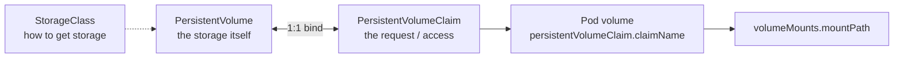

# Storage (10%)

CKA domain: implement StorageClasses and dynamic volume provisioning; configure volume types, access modes and reclaim policies; manage PersistentVolumes and PersistentVolumeClaims. Target: Kubernetes v1.37.

Video: Alta3 Research, "Kubernetes Zero to Hero" (sections below cite timestamps). The Storage chapter (6754s) opens with the tail of the Deployments rollback demo; storage proper begins at 116:24 (6984s), and every video link below is at or after that. Sections without a timestamp come from kubernetes.io/docs. Runnable manifests live in [`examples/04-storage/`](../examples/04-storage/). Cluster for experiments: `kind create cluster --name cka-study --config examples/kind-config.yaml` (kind ships a default StorageClass `standard`).

## The storage chain: class, PV, PVC, volume, mount
<!-- chapter: Storage -->
[video 116:24](https://www.youtube.com/watch?v=MTHGoGUFpvE&t=6984s) | docs: https://kubernetes.io/docs/concepts/storage/persistent-volumes/



- Data inside a container is lost when it dies, so state lives outside it: cloud disk, network storage, or a node directory.
- StorageClass teaches the cluster a kind of storage; PV represents a chunk of it; PVC is the Pod-side request for it. Think of the PVC as the key and the PV as the locker.
- One PVC binds to exactly one PV (docs: a bi-directional `claimRef`). Many Pods may still mount the same PVC, e.g. replicas of one Deployment, subject to the access mode.
- Attaching it to a Pod repeats the ConfigMap/Secret pattern: add the PVC under `volumes`, then reference the volume name under the container's `volumeMounts`.
- PV parameters differ by vendor (AWS, Azure, NFS...); the flow does not.

## PV, PVC and Pod manifest (static binding)
<!-- chapter: Storage -->
[video 123:55](https://www.youtube.com/watch?v=MTHGoGUFpvE&t=7435s) | docs: https://kubernetes.io/docs/concepts/storage/persistent-volumes/

```yaml
# examples/04-storage/pv-pvc.yaml (abridged)
apiVersion: v1
kind: PersistentVolume
metadata: {name: nginx-pv}
spec:
  storageClassName: manual
  capacity: {storage: 3Gi}
  accessModes: [ReadWriteOnce]
  hostPath: {path: /mnt/data}      # directory on the node
---
apiVersion: v1
kind: PersistentVolumeClaim
metadata: {name: nginx-pvc}
spec:
  storageClassName: manual         # same class as the PV
  accessModes: [ReadWriteOnce]
  resources: {requests: {storage: 3Gi}}
```

```bash
kubectl apply -f examples/04-storage/pv-pvc.yaml -f examples/04-storage/pod-with-pvc.yaml
kubectl get pv,pvc            # PV STATUS Available -> Bound once a Pod uses/claims it
```

- The video's demo uses a "manual" class: a directory on a chosen node is the PV (`hostPath`), 3 GiB, `ReadWriteOnce`. Fine for a lab, primitive for real use.
- The video says the PVC finds the PV because they share a class, access mode and size (the claim asks for the PV's full capacity); docs list other ways to guarantee a match (`volumeName`, `selector`).
- Docs on matching: a claim gets at least what it asked for, possibly more; with no big enough PV the claim stays `Pending` until one appears.
- Pod side (`examples/04-storage/pod-with-pvc.yaml`): `volumes[].persistentVolumeClaim.claimName: nginx-pvc`, mounted at `/data`.
- The video pins the Pod to a node with `nodeSelector`, so the hostPath data lands on a known node; use that only when you must. For `hostPath` the PV does not follow the Pod across nodes.
- Live check on the kind cluster (example, your names differ): writing `/data/index.html` in the Pod showed up as `/mnt/data/index.html` on the worker node.

## Access modes
<!-- chapter: Storage -->
[video 124:55](https://www.youtube.com/watch?v=MTHGoGUFpvE&t=7495s) | docs: https://kubernetes.io/docs/concepts/storage/persistent-volumes/#access-modes

| Mode | Short | Meaning (docs) |
|---|---|---|
| `ReadWriteOnce` | RWO | read-write by a single node (several Pods on that node can still share it) |
| `ReadOnlyMany` | ROX | read-only by many nodes |
| `ReadWriteMany` | RWX | read-write by many nodes |
| `ReadWriteOncePod` | RWOP | read-write by a single Pod in the whole cluster (stable since v1.29) |

- The video uses RWO as the common, basic choice.
- Modes describe what the volume can do; the backend must support the one you ask for.

## StorageClass and dynamic provisioning
<!-- gap -->
docs: https://kubernetes.io/docs/concepts/storage/storage-classes/ , https://kubernetes.io/docs/concepts/storage/dynamic-provisioning/

```yaml
# examples/04-storage/storageclass.yaml (abridged)
apiVersion: storage.k8s.io/v1
kind: StorageClass
metadata: {name: local-retain}
provisioner: rancher.io/local-path   # kind's provisioner
reclaimPolicy: Retain                # default is Delete
volumeBindingMode: WaitForFirstConsumer
---
apiVersion: v1
kind: PersistentVolumeClaim
metadata: {name: dynamic-pvc}
spec:
  storageClassName: local-retain
  accessModes: [ReadWriteOnce]
  resources: {requests: {storage: 1Gi}}
```

```bash
kubectl get storageclass                      # (default) marks the default class
kubectl patch storageclass local-retain -p '{"metadata": {"annotations":{"storageclass.kubernetes.io/is-default-class":"true"}}}'
```

- Dynamic provisioning: creating a PVC makes the provisioner create the storage and a matching PV automatically; no hand-written PV. The video's static path is the manual counterpart.
- `provisioner` is required and names the volume plugin/driver; `parameters` are driver-specific; `reclaimPolicy` defaults to `Delete`.
- `volumeBindingMode: Immediate` (default) binds/provisions as soon as the PVC exists; `WaitForFirstConsumer` waits until a Pod using the PVC is scheduled. Live on kind: the PVC stayed `Pending` until a Pod referenced it, then went `Bound`.
- Default class: annotation `storageclass.kubernetes.io/is-default-class: "true"`. A PVC with no `storageClassName` gets it (needs the `DefaultStorageClass` admission controller). If several are marked default, the newest wins.
- `storageClassName: ""` on a PVC opts out of dynamic provisioning (static binding only).

## Reclaim policy and PV phases
<!-- gap -->
docs: https://kubernetes.io/docs/concepts/storage/persistent-volumes/#reclaiming , https://kubernetes.io/docs/tasks/administer-cluster/change-pv-reclaim-policy/

```bash
kubectl patch pv <pv-name> -p '{"spec":{"persistentVolumeReclaimPolicy":"Retain"}}'
kubectl get pv                                # RECLAIM POLICY and STATUS columns
```

| Policy | When the PVC is deleted |
|---|---|
| `Retain` | PV stays, phase `Released`, data kept; not reusable until an admin cleans it up |
| `Delete` | PV object and the backing storage are removed (default for dynamically provisioned PVs, inherited from the class) |
| `Recycle` | deprecated (`rm -rf` scrub); use dynamic provisioning instead |

- PV phases: `Available` (free), `Bound` (claimed), `Released` (claim deleted, not yet reclaimed), `Failed` (automatic reclamation failed).
- Manual reclaim of a `Retain` PV: delete the PV, clean the data on the backing asset, delete the asset (or define a new PV on it).
- Live on kind: after deleting the PVC, both the `manual` PV and the PV dynamically provisioned from a `Retain` class showed `Released` with `CLAIM` still pointing at the deleted PVC.

## Volume types: emptyDir, hostPath, projected
<!-- gap -->
docs: https://kubernetes.io/docs/concepts/storage/volumes/#emptydir , https://kubernetes.io/docs/concepts/storage/volumes/#hostpath , https://kubernetes.io/docs/concepts/storage/projected-volumes/

```yaml
# examples/04-storage/volume-types.yaml (volumes part)
volumes:
  - name: scratch
    emptyDir:
      sizeLimit: 100Mi        # or medium: Memory for tmpfs
  - name: hostlogs
    hostPath:
      path: /var/log
      type: Directory
  - name: merged
    projected:
      sources:
        - configMap: {name: app-config}
        - downwardAPI:
            items:
              - path: labels
                fieldRef: {fieldPath: metadata.labels}
```

```bash
kubectl explain pod.spec.volumes.hostPath.type    # lists the type values
kubectl explain pod.spec.volumes.emptyDir         # medium, sizeLimit
```

- `emptyDir`: created empty when the Pod is assigned to a node; all containers in the Pod can read and write it (mount paths may differ). Data survives container crashes but is deleted permanently when the Pod leaves the node. Live on kind: a file written by one container was read from the other (`examples/04-storage/emptydir-shared.yaml`).
- `emptyDir.medium`: default is the node's medium; the only other allowed value is `Memory`, a tmpfs (RAM) whose files count against the writing container's memory limit.
- `emptyDir.sizeLimit`: caps capacity; docs say it is allocated from node ephemeral storage for the default medium. For `Memory`, `kubectl explain` says usage is capped at the smaller of `sizeLimit` and the sum of container memory limits.
- `hostPath`: a path on the node. `type` values (docs, matches `kubectl explain`): `""` (default, no checks), `Directory`, `DirectoryOrCreate` (creates 0755), `File`, `FileOrCreate` (creates 0644, not the parent directory), `Socket`, `CharDevice`, `BlockDevice`.
- `hostPath` risk (docs): exposes node credentials and the runtime socket (container escape), Pods behave differently per node, and its usage is not counted as ephemeral storage. Avoid it; docs suggest a `local` PersistentVolume instead.
- `projected`: merges `secret`, `configMap`, `downwardAPI`, `serviceAccountToken` (and `clusterTrustBundle`) sources into one directory; all sources must be in the Pod's namespace. Live: the example Pod listed `labels` and `log_level` under `/merged`.
- `configMap` and `secret` volumes are covered in `02-workloads-scheduling.md`.

## Gotchas

Sources: the sections above; reference https://kubernetes.io/docs/concepts/storage/.

- PVC stuck `Pending` with `WaitForFirstConsumer` is normal until a Pod uses it; otherwise check class name, access mode and requested size against available PVs, and `kubectl describe pvc` events.
- A PVC requesting more than any PV offers never binds; a bigger PV may bind (more than requested).
- Class names must match exactly for static binding; `""` means "no class", unset means "default class".
- `Retain` PVs go `Released`, not `Available`; they will not bind a new claim until an admin reclaims them.
- `hostPath` PV data stays on one node; Pods scheduled elsewhere will not see it.
- Deleting a PVC under a `Delete` class destroys the data.
- Dropped as out of scope for the CKA v1.37 curriculum (Storage lists only classes/dynamic provisioning, volume types/access modes/reclaim policies, PV/PVC): VolumeSnapshots and PVC expansion.
