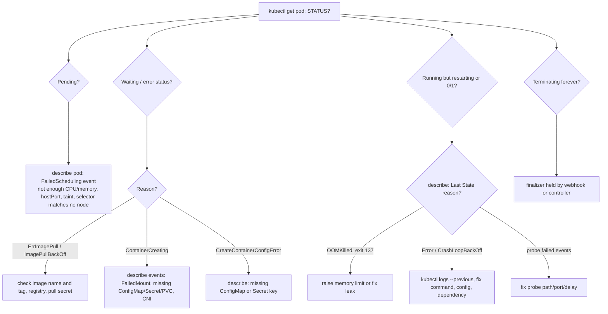
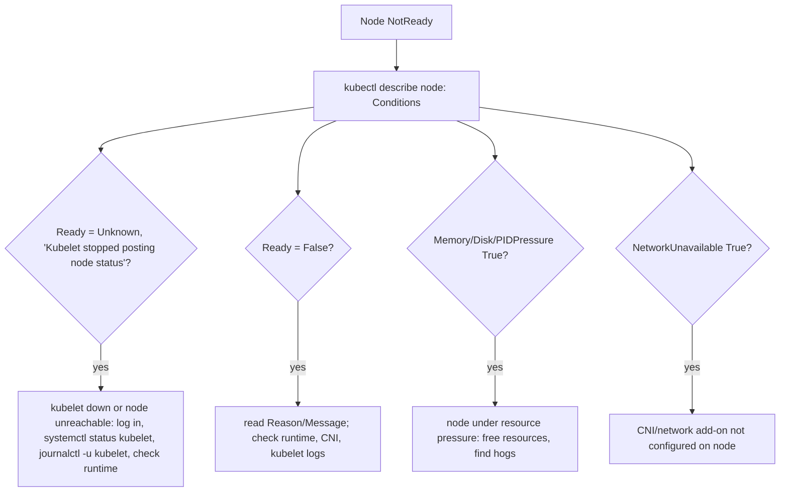
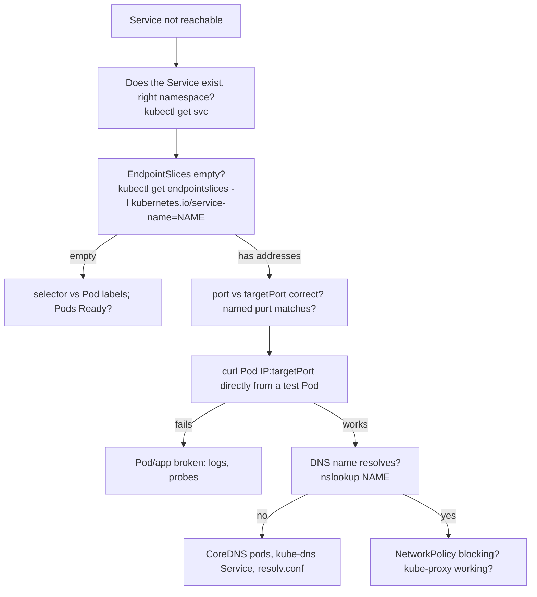

# Troubleshooting (30%)

CKA domain (largest): troubleshoot clusters and nodes; troubleshoot cluster components; monitor cluster and application resource usage; manage and evaluate container output streams; troubleshoot services and networking. Target: Kubernetes v1.37.

Video: Alta3 Research, "Kubernetes Zero to Hero" covers only two pieces of this domain: resource monitoring (`kubectl top`) and logs. Everything else here is `<!-- gap -->` material from kubernetes.io/docs, each section citing its page. Curriculum check (CNCF CKA v1.37, Troubleshooting 30%): troubleshoot clusters and nodes; troubleshoot cluster components; monitor cluster and application resource usage; manage and evaluate container output streams; troubleshoot services and networking. Nothing was dropped as out of scope; the per-Pod failure states (ImagePullBackOff and so on) are kept because they are the day-to-day method for those bullets, though they are not named individually in the curriculum.

Runnable broken-on-purpose manifests live in [`examples/05-troubleshooting/`](../examples/05-troubleshooting/); all pass `kubectl apply --dry-run=server` on the kind cluster `cka-study`.

Outputs marked "example" were captured on that kind cluster (v1.37.0, 1 control plane + 2 workers, namespace `ts-demo`, deleted afterwards); names, IPs and ages differ on yours. Anything destructive (stopping the kubelet, editing static pod manifests, certificate surgery) is documented from kubernetes.io only and marked **not run live**.

## Method: describe, events, logs, then the node
<!-- gap -->
docs: https://kubernetes.io/docs/tasks/debug/debug-application/debug-pods/ | https://kubernetes.io/docs/tasks/debug/debug-application/debug-running-pod/

```bash
kubectl get pod <pod> -o wide                 # STATUS, RESTARTS, which node
kubectl describe pod <pod>                    # container State, Last State, Events (bottom)
kubectl logs <pod> [-c <container>] [--previous]
kubectl exec -it <pod> -- sh                  # if the image has a shell
kubectl debug ...                             # when it has not (see kubectl debug section)
```

- Docs' first step is `kubectl describe pods ${POD_NAME}`: are the containers `Running`, have they restarted recently?
- Not scheduled (`Pending`): read the scheduler message in the events. Scheduled but not running (`Waiting`): usually the image. Scheduled and crashing: logs and `--previous`. Running but wrong: compare the spec you applied to the live one.
- Once past the pod, go outward: Service and endpoints, DNS, NetworkPolicy, then the node (kubelet, runtime), then the control plane. Sections below follow that order.

## Resource usage: kubectl top and metrics-server
<!-- chapter: Resource Monitoring -->
[video 41:43](https://www.youtube.com/watch?v=MTHGoGUFpvE&t=2503s) | [video 42:19](https://www.youtube.com/watch?v=MTHGoGUFpvE&t=2539s) | [video 44:03](https://www.youtube.com/watch?v=MTHGoGUFpvE&t=2643s) | docs: https://kubernetes.io/docs/tasks/debug/debug-cluster/resource-metrics-pipeline/ | https://kubernetes.io/docs/reference/kubectl/generated/kubectl_top/kubectl_top_pod/ | https://kubernetes.io/docs/reference/kubectl/generated/kubectl_top/kubectl_top_node/

```bash
kubectl top node                       # CPU/memory use per node
kubectl top pod                        # current namespace only, like get/describe
kubectl top pod -A --sort-by=memory    # all namespaces, biggest first (cpu | memory)
kubectl top pod mypod --containers     # per-container usage
kubectl top pod -l app=web             # label selector
kubectl top node --show-capacity       # vs Allocatable (the default)
```

- Video: the cluster is the sum of its nodes, so watch consumption against sane guard rails. `kubectl top` is the easy built-in tool, but on a freshly built cluster it fails with "Metrics API not available" until the metrics-server add-on is applied (the video applies a manifest from a Kubernetes GitHub repo; it creates pods that scrape the kubelets, plus RBAC objects so they may do so).
- Video: `top` is namespaced like `get`/`describe`; use `-A` to find the pods hogging resources, a quick way to start troubleshooting.
- Docs: metrics-server collects metrics from each kubelet and serves them through the Metrics API (`metrics.k8s.io`). That needs the API aggregation layer enabled and an `APIService` registered for `metrics.k8s.io`. Repo: https://github.com/kubernetes-sigs/metrics-server (linked from the docs page; install from its releases, not run here).
- Docs: after `kubectl top pod` the numbers may be missing for a few minutes after pod creation (metrics pipeline delay). CPU is average core usage; memory is the working set at the instant collected.
- Docs, kubeadm clusters: kubeadm gives kubelets a self-signed serving certificate, which breaks TLS between metrics-server and kubelet; the fix is signed kubelet serving certs (https://kubernetes.io/docs/setup/production-environment/tools/kubeadm/troubleshooting-kubeadm/ and https://kubernetes.io/docs/tasks/administer-cluster/kubeadm/kubeadm-certs/#kubelet-serving-certs).
- Raw check (docs): `kubectl get --raw "/apis/metrics.k8s.io/v1/nodes/<node>"` returns `usage.cpu`/`usage.memory`.
- **This kind cluster has no metrics-server** (no `metrics.k8s.io` APIService; nothing was installed). Actual behaviour, example:

```text
$ kubectl top nodes
error: Metrics API not available
$ kubectl top pods -A
error: Metrics API not available
```

## Container logs: default container, -c, --all-containers, -f
<!-- chapter: Viewing Logs -->
[video 85:04](https://www.youtube.com/watch?v=MTHGoGUFpvE&t=5104s) | [video 86:14](https://www.youtube.com/watch?v=MTHGoGUFpvE&t=5174s) | [video 87:27](https://www.youtube.com/watch?v=MTHGoGUFpvE&t=5247s) | [video 88:02](https://www.youtube.com/watch?v=MTHGoGUFpvE&t=5282s) | docs: https://kubernetes.io/docs/reference/kubectl/generated/kubectl_logs/

```bash
kubectl apply -f examples/05-troubleshooting/counter-two-containers.yaml
kubectl logs counter                          # "Defaulted container "count" out of: count, count-by-three"
kubectl logs counter -c count-by-three        # one specific container
kubectl logs counter --all-containers --prefix
kubectl logs counter -c count-by-three -f     # stream (follow)
```

- Video: every container in a Pod produces its own log: whatever it writes to stdout and stderr. `kubectl logs` works only on Pod containers, so no resource type is needed.
- Video: a Pod with two busybox containers (one prints every 1 s, one every 3 s). Plain `kubectl logs` picks the first container listed and says so ("defaulted container"); `-c <name>` selects another; `--all-containers` merges both; `-f` streams.
- Docs for the flags: `--prefix` prepends `pod/container` to each line; `--all-containers`; `-c, --container`; `-f, --follow`.
- Example (captured live):

```text
$ kubectl logs counter
Defaulted container "count" out of: count, count-by-three
0: Sat Nov  7 19:54:01 UTC 2026
$ kubectl logs counter --all-containers --prefix --tail=2
[pod/counter/count] 85: Sat Nov  7 19:55:26 UTC 2026
[pod/counter/count] 86: Sat Nov  7 19:55:27 UTC 2026
[pod/counter/count-by-three] 27: Sat Nov  7 19:55:22 UTC 2026
[pod/counter/count-by-three] 28: Sat Nov  7 19:55:25 UTC 2026
```

## More log options: --previous, selectors, --tail, --since
<!-- chapter: Viewing Logs -->
[video 87:27](https://www.youtube.com/watch?v=MTHGoGUFpvE&t=5247s) | docs: https://kubernetes.io/docs/reference/kubectl/generated/kubectl_logs/ | https://kubernetes.io/docs/tasks/debug/debug-application/debug-running-pod/

```bash
kubectl logs mypod -c app --previous         # -p: the previous (crashed) instance of the container
kubectl logs -l app=web --all-containers     # by label, all matching pods
kubectl logs -l app=web --max-log-requests=10 -f   # following many pods: default cap is 5
kubectl logs deployment/web -c nginx         # via a workload
kubectl logs mypod --tail=20                 # last 20 lines
kubectl logs mypod --since=1h --timestamps   # relative window (5s, 2m, 3h) / RFC3339 via --since-time
kubectl logs job/hello                       # logs of a Job (docs: first container)
```

- The video covers `-c`, `--all-containers` and `-f`; the rest is from the docs reference page (video-covered topic, supplemented).
- Docs: `-p/--previous` prints logs of the previous container instance "if it exists"; docs on debugging running Pods use it for a container that has crashed.
- Docs: `--tail` defaults to all lines without a selector, but 10 lines when `-l` is used; `-l` supports `=`, `==`, `!=`, `in`, `notin`; `--limit-bytes` caps output.
- Example, kind: `kubectl logs failing-probe --previous` returned the previous nginx instance's shutdown lines, but for the `crashloop` Pod `--previous` answered `unable to retrieve container logs for containerd://<id>` while plain `kubectl logs crashloop` showed the line the container printed. If `--previous` gives nothing, fall back to `describe` (Last State, exit code) and the termination message below.
- Termination message (docs, https://kubernetes.io/docs/tasks/debug/debug-application/determine-reason-pod-failure/): a container can write a short final status to `terminationMessagePath` (default `/dev/termination-log`). With `terminationMessagePolicy: FallbackToLogsOnError` the last chunk of log (up to 2048 bytes or 80 lines) is used if the file is empty and the container failed.

```bash
kubectl get pod mypod -o go-template="{{range .status.containerStatuses}}{{.lastState.terminated.message}}{{end}}"
```

## kubectl describe and events
<!-- gap -->
docs: https://kubernetes.io/docs/tasks/debug/debug-application/debug-pods/ | https://kubernetes.io/docs/reference/kubectl/generated/kubectl_events/ | https://kubernetes.io/docs/concepts/workloads/pods/pod-lifecycle/

```bash
kubectl describe pod mypod                      # Events section is at the bottom
kubectl describe node mynode                    # Conditions, Taints, Allocatable, Events
kubectl events                                  # recent events, current namespace
kubectl events -A --types=Warning               # only warnings, all namespaces
kubectl events --for pod/mypod --watch          # events for one object, stream new ones
```

- Docs on `describe pod`: each container's state is `Waiting`, `Running` or `Terminated`; `Ready` says whether the last readiness probe passed (assumed ready with no probe); `Restart Count` helps spot crash loops; Events list "From" (the component, e.g. `default-scheduler`, `kubelet`), Reason and Message.
- Docs: `Waiting` carries a Reason (pulling image, applying Secret data...); `Terminated` carries Reason, exit code, start/finish time.
- `kubectl events` flags (docs): `-A`, `--for TYPE/NAME`, `--types`, `-w/--watch`, `--no-headers`.
- Example, kind (`failing-probe.yaml`), events from `describe`:

```text
Warning  Unhealthy  Liveness probe failed: HTTP probe failed with statuscode: 404
Warning  Unhealthy  Readiness probe failed: HTTP probe failed with statuscode: 404
Normal   Killing    Container web failed liveness probe, will be restarted
Warning  BackOff    Back-off restarting failed container web in pod failing-probe_ts-demo(...)
```

## Pod-state decision flowchart
<!-- gap -->
docs: https://kubernetes.io/docs/tasks/debug/debug-application/debug-pods/ | https://kubernetes.io/docs/concepts/workloads/pods/pod-lifecycle/ | https://kubernetes.io/docs/tasks/debug/debug-application/debug-running-pod/



| STATUS you see | Where the cause shows | Typical fix |
|---|---|---|
| `Pending` | `describe` Events from `default-scheduler` | free or add resources, lower requests, fix hostPort/selectors/taints |
| `ErrImagePull` then `ImagePullBackOff` | Events from `kubelet` ("Failed to pull image") | correct image/tag, push it, add `imagePullSecrets` |
| `ContainerCreating` (stuck) | Events: `FailedMount` | create the missing ConfigMap/Secret/PVC |
| `CreateContainerConfigError` | Events: `Error: configmap "x" not found` | create it or fix the reference |
| `CrashLoopBackOff` / `Error` | `logs`, `logs --previous`, Last State exit code | fix the app command/config |
| `OOMKilled` | Last State Reason `OOMKilled`, Exit Code 137 | raise `limits.memory` or fix the app |
| `Running` but `0/1` Ready | Events: `Readiness probe failed` | fix probe or app port |

- Docs (Pending): the Pod cannot be scheduled, usually insufficient resources (delete Pods, adjust requests, add nodes) or `hostPort` conflicts (at most one Pod per node per hostPort; prefer a Service).
- Docs (Waiting): most common cause is an image that cannot be pulled: check the name, that it was pushed, and try pulling manually.
- Docs (restarts): `restartPolicy` is `Always` (default), `OnFailure` or `Never`; the kubelet restarts exited containers with exponential backoff of 10s, 20s, 40s... capped at 300s, reset after 10 minutes of healthy running. That backoff is what `CrashLoopBackOff` means.
- Docs (Terminating): a stuck deletion is typically a finalizer plus an admission webhook that blocks removing it; look for Validating/MutatingWebhookConfigurations targeting `UPDATE` on `pods`.
- Docs (Running but not doing what you intended): a mistyped field is silently ignored. Recreate with `kubectl apply --validate -f mypod.yaml`, and compare `kubectl get pods/mypod -o yaml > mypod-on-apiserver.yaml` against your file (lines missing on the server are the problem).

## Reproduced pod failures (examples)
<!-- gap -->
docs: https://kubernetes.io/docs/tasks/debug/debug-application/debug-pods/ | https://kubernetes.io/docs/tasks/configure-pod-container/assign-memory-resource/ | https://kubernetes.io/docs/concepts/containers/images/

```bash
kubectl create ns ts-demo
kubectl apply -n ts-demo -f examples/05-troubleshooting/      # all broken on purpose
kubectl get pods -n ts-demo
kubectl delete ns ts-demo                                     # clean up
```

Files: `bad-image.yaml`, `crashloop.yaml`, `oomkilled.yaml`, `failing-probe.yaml`, `missing-configmap.yaml` (two Pods), `unschedulable.yaml`, `selector-mismatch.yaml` (Deployment + Service), `counter-two-containers.yaml` (logs demo). Captured live, example output:

```text
NAME             READY  STATUS                       RESTARTS
bad-image        0/1    ErrImagePull                 0
crashloop        0/1    Error                        3 (48s ago)      # alternates with CrashLoopBackOff
env-missing      0/1    CreateContainerConfigError   0
failing-probe    0/1    CrashLoopBackOff             4 (14s ago)
oom              0/1    OOMKilled                    3 (48s ago)
too-big          0/1    Pending                      0
volume-missing   0/1    ContainerCreating            0
```

```text
# bad-image: describe Events
Warning  Failed   Failed to pull image "nginx:1.27-this-tag-does-not-exist": ... not found
Warning  Failed   Error: ErrImagePull
Normal   BackOff  Back-off pulling image "nginx:1.27-this-tag-does-not-exist"
Warning  Failed   Error: ImagePullBackOff

# too-big (requests cpu "100"): describe Events
Warning  FailedScheduling  0/3 nodes are available: 1 node(s) had untolerated taint(s), 2 Insufficient cpu. preemption: ...

# env-missing:    Warning  Failed       Error: configmap "app-settings" not found
# volume-missing: Warning  FailedMount  MountVolume.SetUp failed for volume "cfg" : configmap "app-settings" not found

# oom: describe
Last State:  Terminated
  Reason:    OOMKilled
  Exit Code: 137
```

- `ErrImagePull` is the first failure; `ImagePullBackOff` is the kubelet waiting before retrying. Both mean the same fix.
- The `untolerated taint` part of the Pending message is the control-plane node's taint, so only the 2 workers were candidates.
- OOMKilled matches the docs example (`lastState.terminated.reason: OOMKilled`, `exitCode: 137`) from the memory-limit task.
- ConfigMap trap: a missing ConfigMap in `env.valueFrom` gives `CreateContainerConfigError`; a missing one used as a volume leaves the Pod in `ContainerCreating` with a `FailedMount` event. Different symptom, same cause.
- `selector-mismatch.yaml`: see the Services section.

## Node NotReady triage
<!-- gap -->
docs: https://kubernetes.io/docs/reference/node/node-status/ | https://kubernetes.io/docs/tasks/debug/debug-cluster/

```bash
kubectl get nodes
kubectl describe node <node>        # Conditions, Taints, Events
kubectl cluster-info dump           # overall cluster health detail (large output)
```



- Docs, conditions: `Ready` is `True` (healthy), `False` (unhealthy, not accepting pods) or `Unknown` (node controller has not heard from the node within `node-monitor-grace-period`, default 50 seconds). `DiskPressure`, `MemoryPressure`, `PIDPressure` are `True` when the resource is low; `NetworkUnavailable` is `True` when the node network is not correctly configured.
- Docs: `Ready` stuck `Unknown`/`False` past the grace period makes the control plane add the taint `node.kubernetes.io/unreachable` (Unknown) or `node.kubernetes.io/not-ready` (False). The debug-cluster page's example shows pods evicted after five minutes of NotReady.
- Docs, heartbeats: the kubelet updates the Node `.status` and a Lease in the `kube-node-lease` namespace (every 10 seconds by default). A dead kubelet stops both, hence `Unknown`.
- Docs example of a down node: all four conditions `Unknown` with Reason `NodeStatusUnknown` and Message "Kubelet stopped posting node status." plus the unreachable taints.
- Triage: describe the node, then (SSH or console) check the kubelet service and logs, then the container runtime, then the CNI plugin. `kubectl debug node/...` will not work if the node is down (docs); you need direct access.
- Example, healthy node on kind (`describe node`):

```text
MemoryPressure  False  KubeletHasSufficientMemory  kubelet has sufficient memory available
DiskPressure    False  KubeletHasNoDiskPressure    kubelet has no disk pressure
PIDPressure     False  KubeletHasSufficientPID     kubelet has sufficient PID available
Ready           True   KubeletReady                kubelet is posting ready status
```

## kubelet and container runtime: systemctl, journalctl, crictl
<!-- gap -->
docs: https://kubernetes.io/docs/concepts/cluster-administration/system-logs/ | https://kubernetes.io/docs/setup/production-environment/tools/kubeadm/kubelet-integration/ | https://kubernetes.io/docs/tasks/debug/debug-cluster/crictl/ | https://kubernetes.io/docs/setup/production-environment/tools/kubeadm/troubleshooting-kubeadm/

```bash
# on the node (kind: docker exec -it cka-study-worker bash)
systemctl status kubelet              # is it active? last log lines
journalctl -u kubelet --no-pager -n 50
systemctl status containerd
crictl ps -a                          # all containers, including Exited
crictl pods
crictl logs <container-id> --tail=20
```

- Docs: the kubelet and container runtime do not run in containers; on systemd machines they write to **journald** (otherwise `.log` files in `/var/log`). So read them with `journalctl`, not `kubectl logs`.
- Caveat on sources: the docs pages I could retrieve confirm journald, `systemctl restart kubelet` and `systemctl daemon-reload` but do not spell out the `systemctl status`/`journalctl -u kubelet` lines; those two were run live read-only on the kind nodes instead (below).
- kubeadm files (docs): kubelet config `/var/lib/kubelet/config.yaml`; instance flags in `/var/lib/kubelet/kubeadm-flags.env` (includes the cgroup driver); kubeconfig for the kubelet `/etc/kubernetes/kubelet.conf`. kubeadm applies changes with `systemctl daemon-reload && systemctl restart kubelet`.
- `crictl` (docs): `crictl ps -a` shows all containers including `Exited`; `crictl logs`, `crictl pods`, `crictl images`, `crictl exec -i -t <id> ls`. Endpoint via `--runtime-endpoint`, `CONTAINER_RUNTIME_ENDPOINT` or `/etc/crictl.yaml` (e.g. `runtime-endpoint: unix:///var/run/containerd/containerd.sock`).
- kubelet client certificate rotation failure (docs): API server logs show `x509: certificate has expired or is not yet valid`. Procedure: back up and remove `/etc/kubernetes/kubelet.conf` and `/var/lib/kubelet/pki/kubelet-client*` on the failed node; on a control-plane node holding `/etc/kubernetes/pki/ca.key` run `kubeadm kubeconfig user --org system:nodes --client-name system:node:$NODE > kubelet.conf`; copy it back, point `client-certificate`/`client-key` at `/var/lib/kubelet/pki/kubelet-client-current.pem`, `systemctl restart kubelet`, confirm the node is `Ready`. **Not run live.**
- Stopping or restarting the kubelet or containerd to reproduce failures was **not run live** (shared cluster).
- Example, read-only on the kind worker: `systemctl is-active kubelet containerd` printed `active` twice; `systemctl status kubelet` showed `Active: active (running)` with drop-ins `10-kubeadm.conf, 11-kind.conf`; `journalctl -u kubelet -n 4` showed kubelet lines such as `Error syncing pod, skipping ... CreateContainerConfigError: configmap "app-settings" not found pod="ts-demo/env-missing"` (the kubelet logs pod problems too); `crictl ps` listed the `ts-demo` containers; `/etc/crictl.yaml` held `runtime-endpoint: unix:///run/containerd/containerd.sock`.

## Control-plane component failures: static pods
<!-- gap -->
docs: https://kubernetes.io/docs/tasks/configure-pod-container/static-pod/ | https://kubernetes.io/docs/reference/setup-tools/kubeadm/implementation-details/ | https://kubernetes.io/docs/tasks/debug/debug-cluster/

```bash
ls /etc/kubernetes/manifests          # on a control-plane node
#   etcd.yaml  kube-apiserver.yaml  kube-controller-manager.yaml  kube-scheduler.yaml
grep staticPodPath /var/lib/kubelet/config.yaml
kubectl get pods -n kube-system                      # mirror pods (name ends in the node name)
kubectl logs -n kube-system kube-apiserver-<node>
crictl ps -a                                         # works even when the API server is down
crictl logs <container-id>
```

- Docs (kubeadm): static Pod manifests live in `/etc/kubernetes/manifests` and are named `etcd.yaml`, `kube-apiserver.yaml`, `kube-controller-manager.yaml`, `kube-scheduler.yaml`. Component kubeconfigs are in `/etc/kubernetes/`: `kubelet.conf`, `controller-manager.conf`, `scheduler.conf`, `admin.conf`, `super-admin.conf`.
- Docs (static Pods): the kubelet reads `staticPodPath` from its config file, periodically scans that directory, and creates/deletes the static Pods as files appear or disappear; it ignores files starting with a dot. The API server only shows a read-only mirror Pod; deleting the mirror with `kubectl` does not remove the static Pod. If you stop its container (`crictl stop`) the kubelet restarts it.
- Docs: the kubelet processes every non-dot file in the directory, no extension filter, so a stray `kube-apiserver.yaml.backup` there causes undefined behaviour. Keep backups elsewhere (e.g. `/etc/kubernetes/backup/`).
- Debug approach: if the API server is down `kubectl` fails, so go to the node: `crictl ps -a` to see whether the container is `Exited`, `crictl logs <id>` for why, then check the manifest YAML (typos in flags, wrong paths, bad certificate file names), then `journalctl -u kubelet` (the kubelet reports why it could not create the static pod). Fix = correct the manifest; per the docs the kubelet rescans the directory and recreates the static Pod from the file. **Not run live** (editing or moving a manifest on the shared cluster would break it).
- Docs on impact (debug-cluster page): API server down means you cannot stop, update or start new pods/services/controllers while existing pods and services keep working unless they depend on the API; lost API server storage (etcd) means kube-apiserver fails to start while kubelets keep running the same pods; scheduler/controller-manager crashes have similar consequences to the API server as they are co-located and keep no persistent state of their own.
- If `kubeadm init` hangs on "waiting for the control plane to become ready", docs say control-plane containers are crashlooping; investigate each with the container runtime tools (crictl).
- Example, kind control plane: `ls /etc/kubernetes/manifests` listed exactly the four files; `staticPodPath: /etc/kubernetes/manifests`; `kubectl get pods -n kube-system` showed `kube-apiserver-cka-study-control-plane`, `etcd-...`, `kube-controller-manager-...`, `kube-scheduler-...` (all `Running`); `crictl ps --name kube-apiserver` on the node showed the same container.

## Cluster component logs
<!-- gap -->
docs: https://kubernetes.io/docs/concepts/cluster-administration/system-logs/ | https://kubernetes.io/docs/tasks/debug/debug-cluster/ | https://kubernetes.io/docs/tasks/debug/debug-cluster/kubectl-node-debug/

| Component | Where (kubeadm-style cluster) | Command |
|---|---|---|
| kube-apiserver, scheduler, controller-manager, etcd | static pods in `kube-system` | `kubectl logs -n kube-system <pod>`; `crictl logs` if the API is down |
| kube-proxy, CoreDNS, CNI | pods (kube-proxy, CoreDNS in `kube-system`) | `kubectl logs -n kube-system -l k8s-app=kube-dns` |
| kubelet, container runtime | systemd services, journald | `journalctl -u kubelet` on the node |

- Docs (system-logs): components that run in containers (scheduler, kube-proxy) always write `.log` files in `/var/log`, bypassing the default mechanism; the kubelet and runtime use journald on systemd machines. Output goes to stderr and the invoker (systemd, shell) handles redirection.
- Docs (debug-cluster) classic file locations when logs are files (on systemd systems you may need `journalctl` instead): control plane `/var/log/kube-apiserver.log`, `/var/log/kube-scheduler.log`, `/var/log/kube-controller-manager.log`; workers `/var/log/kubelet.log`, `/var/log/kube-proxy.log`.
- Docs (`-v`): verbosity flag; 0 logs only critical events, higher numbers log more (less severe) events.
- Node log query through the API (docs; needs the kubelet option `enableSystemLogHandler`, default `false`):

```bash
kubectl get --raw "/api/v1/nodes/<node>/proxy/logs/?query=kubelet"
kubectl get --raw "/api/v1/nodes/<node>/proxy/logs/?query=kubelet&pattern=error"
```

  Docs warn that permission on `nodes/proxy` (even `get`) lets a user reach powerful kubelet APIs, including running commands in any container on the node. Example, kind: this returned an HTML index page rather than kubelet log lines, i.e. the handler is not enabled there.
- Docs (`kubectl debug node`): the node's root filesystem is mounted at `/host`, so you can read `/host/var/log/kubelet.log`, `/host/var/log/containerd.log`, `/host/var/log/syslog` and `/host/var/log/kern.log` if the node writes those files. Not run live.

## Services, endpoints and DNS
<!-- gap -->
docs: https://kubernetes.io/docs/tasks/debug/debug-application/debug-service/ | https://kubernetes.io/docs/tasks/administer-cluster/dns-debugging-resolution/ | https://kubernetes.io/docs/tasks/debug/debug-application/debug-pods/



```bash
kubectl get svc web
kubectl get endpointslices -l kubernetes.io/service-name=web
kubectl get pods --selector=app=web          # same selector the Service uses
kubectl get service web -o json              # check ports[], targetPort, selector
kubectl run -it --rm --restart=Never busybox --image=registry.k8s.io/busybox:1.27.2 sh   # in-cluster test shell
```

- Docs: the API server keeps one or more EndpointSlices per Service; the endpoint count should match the Pods you expect. `<none>` under ENDPOINTS means the Service `spec.selector` does not match any Pod's `metadata.labels` (typo, or `run=` vs `app=`); also each Pod's `containerPort` should match the Service's `targetPort`.
- Docs checks of `spec.ports[]`: is the port listed, is `targetPort` right for the Pods, number vs string, named port exposed by the Pods, `protocol`.
- Test the Pods directly (docs): from a Pod, `wget -qO- <podIP>:<targetPort>` for each endpoint. Pod port, not the Service port.
- Example, kind (`selector-mismatch.yaml`: Service selects `app=webb`, Pods are `app=web`):

```text
$ kubectl get endpointslices -l kubernetes.io/service-name=web
NAME        ADDRESSTYPE   PORTS     ENDPOINTS
web-gmcrt   IPv4          <unset>   <unset>
$ kubectl get pods --selector=app=webb
No resources found in ts-demo namespace.
$ curl -s -m4 http://web      # from a test Pod
curl exit 7
# after patching the selector to app=web: endpoints show both Pod IPs and curl returns the nginx page
```

DNS (docs):

```bash
kubectl apply -f https://k8s.io/examples/admin/dns/dnsutils.yaml
kubectl exec -i -t dnsutils -- nslookup kubernetes.default
kubectl exec -ti dnsutils -- cat /etc/resolv.conf
kubectl get pods --namespace=kube-system -l k8s-app=kube-dns
kubectl logs --namespace=kube-system -l k8s-app=kube-dns
kubectl get svc --namespace=kube-system                        # Service is named kube-dns
kubectl get endpointslice -l kubernetes.io/service-name=kube-dns --namespace=kube-system
kubectl -n kube-system edit configmap coredns                  # add the `log` plugin to see queries (not run live)
```

- Docs: names are `<service>.<namespace>.svc.<cluster-domain>` (default domain `cluster.local`); inside a Pod use `nslookup hostnames`, `nslookup hostnames.default`, or the full name. The label `k8s-app=kube-dns` is kept for compatibility even though the pods are CoreDNS.
- Example, kind (DNS test Pod made from the agnhost image used by the docs manifest, started with `--command -- sleep 900`): `nslookup kubernetes.default` returned `10.96.0.1` via server `10.96.0.10`; `nslookup web` returned `web.ts-demo.svc.cluster.local`; `/etc/resolv.conf` had `search ts-demo.svc.cluster.local svc.cluster.local cluster.local ...`, `nameserver 10.96.0.10`, `options ndots:5`; two `coredns-*` pods Running and the `kube-dns` EndpointSlice listed two addresses.
- kube-proxy (docs; on a node; **not run live**): `ps auxw | grep kube-proxy`; check its logs (file or `journalctl`, depending on OS) for errors reaching the control plane and for the mode line (`Using iptables Proxier`); in iptables mode `iptables-save | grep <svc>` shows a `KUBE-SERVICES` rule, a `KUBE-SVC-<hash>` chain and `KUBE-SEP-<hash>` chains per endpoint; in ipvs mode `ipvsadm -ln` lists a virtual server per Service port. Then `curl <clusterIP>:<port>` from a node.
- Kubeadm docs: many CNI add-ons do not enable hairpin mode, so a Pod may fail to reach itself through its own Service IP. CoreDNS stays `Pending` until a pod network add-on is installed (expected).

## NetworkPolicy debugging
<!-- gap -->
docs: https://kubernetes.io/docs/concepts/services-networking/network-policies/ | https://kubernetes.io/docs/tasks/debug/debug-application/debug-service/

```bash
kubectl get networkpolicy -n <ns>
kubectl describe networkpolicy <name> -n <ns>       # podSelector, allowed ingress/egress, policy types
kubectl get pods -n <ns> --show-labels              # does the policy's podSelector match?
```

- Docs: the cluster needs a network plugin that enforces NetworkPolicy; without a controller implementing it, creating the resource "will have no effect".
- Docs: pods are non-isolated by default (all ingress and egress allowed). A Pod becomes isolated for ingress (egress) when some policy selects it and lists `Ingress` (`Egress`) in `policyTypes`; then only what some policy's `ingress`/`egress` list allows (plus, for ingress, traffic from the Pod's own node) gets through.
- Docs: policies are additive (union of allows), never conflicting; order does not matter. For a connection, both the source's egress policy and the destination's ingress policy must allow it.
- Debug flow (docs: Debug Services says to review NetworkPolicy ingress rules affecting the backend Pods): service has endpoints and Pod IP works from a pod in the same policy scope but not from another namespace or Pod, so list the policies selecting the backend Pods and check `namespaceSelector`/`podSelector` rules against the client's labels; remember DNS egress when you deny egress.
- Example, kind (kindnet enforces policies here): a policy with `podSelector: {matchLabels: {app: web}}` and `policyTypes: [Ingress]` and no rules turned a working `curl http://web` from a test Pod into `curl exit 28` (timeout); `describe` showed "Allowing ingress traffic: <none> (Selected pods are isolated for ingress connectivity)"; deleting the policy restored `curl exit 0`. See `examples/03-networking/networkpolicy-default-deny.yaml` for the manifest form.

## kubectl debug
<!-- gap -->
docs: https://kubernetes.io/docs/tasks/debug/debug-application/debug-running-pod/ | https://kubernetes.io/docs/reference/kubectl/generated/kubectl_debug/ | https://kubernetes.io/docs/tasks/debug/debug-cluster/kubectl-node-debug/

```bash
# 1. Ephemeral container in the running Pod (image has no shell / crashed)
kubectl debug -it ephemeral-demo --image=busybox:1.28 --target=ephemeral-demo

# 2. Copy of the Pod with a different command (crashing app)
kubectl debug myapp -it --copy-to=myapp-debug --container=myapp -- sh

# 3. Copy of the Pod with a debug container added
kubectl debug myapp -it --image=ubuntu --share-processes --copy-to=myapp-debug

# 4. Copy with images swapped
kubectl debug myapp --copy-to=myapp-debug --set-image=*=ubuntu

# 5. Shell on a node (host fs at /host)
kubectl debug node/mynode -it --image=ubuntu
kubectl delete pod node-debugger-mynode-<suffix>       # clean up
```

- Docs: ephemeral containers help when `kubectl exec` is insufficient: a crashed container, or an image without debugging tools (e.g. distroless). `--target` targets another container's process namespace and must be supported by the runtime; the docs create their demo Pod with `registry.k8s.io/pause:3.1`, which has no shell, so `kubectl exec ... -- sh` fails and `kubectl debug` works.
- Docs: adding an ephemeral container needs the `pods/ephemeralcontainers` subresource (update/patch); it is not in the default `admin`/`edit` ClusterRoles. Without it: `cannot patch resource "pods/ephemeralcontainers"`.
- Docs: copy modes (`--copy-to`) leave the original Pod untouched; `--container` is needed to change the command of an existing container (otherwise a new container is created); `-i` attaches, `--attach=false` prevents it, `kubectl attach` reattaches; `--share-processes` lets containers see each other's processes; `--set-image` uses `container=image` pairs, `*=ubuntu` means all containers; `--same-node` schedules the copy on the same node.
- Docs: node mode runs a Pod on the node in the host IPC, network and PID namespaces with the node filesystem at `/host`; the Pod is not privileged, so `chroot /host` may fail; use `--profile=sysadmin` for a privileged one. It does not work when the node is down.
- Profiles (docs): `legacy`, `general`, `baseline`, `restricted`, `netadmin`, `sysadmin`. The two docs pages disagree about the default (`kubectl debug` reference says `general`, the concept page says `legacy`), so pass `--profile` explicitly, e.g. `--profile=restricted` where Pod Security `restricted` applies.
- Example, kind (live, throwaway namespace): `kubectl debug ephemeral-demo --image=busybox:1.36 --target=ephemeral-demo --profile=general -- sh -c 'ps'` listed `/pause` as PID 1 next to the debugger's own processes, so the process namespace was shared; `kubectl get pod ephemeral-demo -o jsonpath='{.spec.ephemeralContainers[*].name}'` showed the generated container name `debugger-<suffix>`. Copy mode with a changed command also ran its `sh -c` (non-interactive here, so kubectl warned it could not attach and streamed logs instead). Node mode was **not run live**.

## Gotchas

Sources: the sections above, each gotcha from the page that section cites: https://kubernetes.io/docs/reference/kubectl/generated/kubectl_logs/ (logs flags), https://kubernetes.io/docs/tasks/debug/debug-cluster/resource-metrics-pipeline/ (`kubectl top`), https://kubernetes.io/docs/tasks/debug/debug-application/debug-service/ (Services, endpoints), https://kubernetes.io/docs/tasks/configure-pod-container/static-pod/ (static Pods), https://kubernetes.io/docs/concepts/services-networking/network-policies/ (NetworkPolicy).

- `kubectl top` needs metrics-server; "Metrics API not available" means it is missing or its APIService is not `Available`. Numbers lag for a few minutes after a Pod is created.
- Plain `kubectl logs` on a multi-container Pod silently picks the first container; use `-c` or `--all-containers`.
- `kubectl logs -l` shows only 10 lines per Pod by default (`--tail` defaults to 10 with a selector) and follows at most 5 Pods at once (`--max-log-requests`).
- `--previous` is the previous (crashed) instance of the container; plain `logs` is the current one.
- `describe` events are at the bottom and are the first place to look; `kubectl events --for pod/x` filters the same data.
- `STATUS` can alternate between `Error` and `CrashLoopBackOff` while the kubelet backs off (10s, 20s, 40s... up to 300s).
- A missing ConfigMap gives `CreateContainerConfigError` in `env` but `ContainerCreating` with `FailedMount` as a volume.
- `OOMKilled` is exit code 137 on the container's Last State, not in `kubectl logs`.
- `Service` with empty EndpointSlices: compare selector and Pod labels first.
- Test from inside the cluster (a throwaway Pod), not from your laptop, and test Pod IP:targetPort before blaming the Service.
- NetworkPolicy does nothing if the CNI does not enforce it; once a policy selects a Pod, everything not allowed is denied (including DNS egress if you restrict egress).
- You cannot delete a static Pod with `kubectl`; remove or fix the manifest on the node, and keep non-manifest files out of `/etc/kubernetes/manifests`.
- The kubelet and containerd log to journald, so `kubectl logs` cannot show them; `kubectl debug node` will not work if the node is down.
- Do not grant `nodes/proxy` casually, and `pods/ephemeralcontainers` is a separate RBAC permission.
